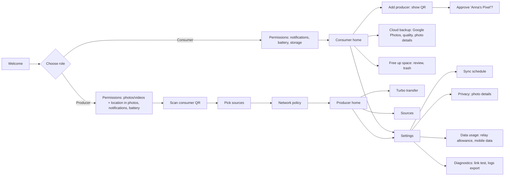
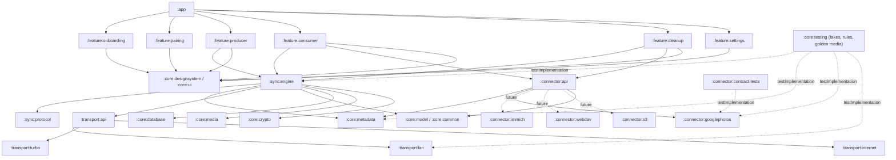
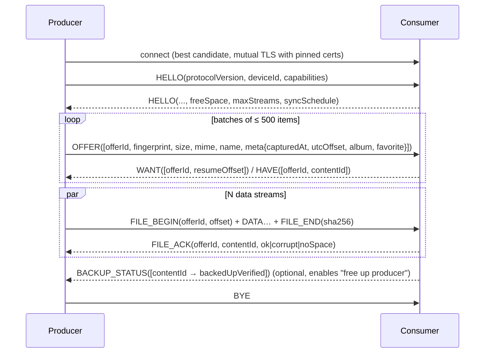

# MediaSync — Development Plan

> Status: **rev. 5: approved; M0 in progress** · 2026-10-13 · Author: Daniel Kosc (with Claude)
> Approved. Key decisions are recorded as ADRs in [docs/adr](adr). M0 (foundations) is implemented.

MediaSync is an Android app that moves photos and videos from one or more **producer** phones to a single **consumer** device as fast as the network allows. All metadata is kept. The consumer can optionally back the media up to the cloud (Google Photos first, more connectors later) and then free local space safely.

---

## Table of contents

1. [Decisions from your answers](#1-decisions-from-your-answers)
2. [Product scope](#2-product-scope)
3. [UX and UI](#3-ux-and-ui)
4. [Architecture](#4-architecture)
5. [Sync engine and wire protocol](#5-sync-engine-and-wire-protocol)
6. [Metadata: preservation and privacy](#6-metadata-preservation-and-privacy)
7. [Maximizing transfer speed](#7-maximizing-transfer-speed)
8. [Connectivity: Wi-Fi, Turbo transfer, internet](#8-connectivity-wi-fi-turbo-transfer-internet)
9. [Cloud backup connectors](#9-cloud-backup-connectors)
10. [Background execution and power policy](#10-background-execution-and-power-policy)
11. [Security and privacy](#11-security-and-privacy)
12. [Permissions and Play Store policy](#12-permissions-and-play-store-policy)
13. [Testing strategy](#13-testing-strategy)
14. [Repository, CI/CD and engineering standards](#14-repository-cicd-and-engineering-standards)
15. [Roadmap and milestones](#15-roadmap-and-milestones)
16. [Risks and mitigations](#16-risks-and-mitigations)
17. [Recommended extra features](#17-recommended-extra-features)
18. [Open questions for you](#18-open-questions-for-you)
19. [References](#19-references)

---

## 1. Decisions from your answers

### 1.1 Google Photos upload quality: MediaSync provides its own "Storage saver"

**Constraint.** Since 31 March 2025, the Google Photos Library API no longer lets third-party apps read a user's library. Apps can only add items and read back the items they created. MediaSync therefore can't ask "has the Google Photos app already backed up this file?". Instead, the consumer uploads the media itself and keeps its own record of what it uploaded.

**Your request:** let the user choose *Original quality* or a *data/storage saver* mode.

**Finding:** the API offers **no quality parameter**. Every upload is stored "in full resolution at original quality", and uploads count toward the user's Google storage.

> **On your Pixel 2 XL this isn't needed.** There, the Google Photos app uploads in Storage saver for free (§1.5). MediaSync's own saver applies to the API connector (v1.1) on consumers without that perk.

**Design:** MediaSync implements the saver itself, on the consumer and only right before upload:

| Mode | Photos | Videos | Notes |
|---|---|---|---|
| **Original** (default) | Byte-identical upload | Byte-identical upload | Lossless. Safe to delete the local copy afterwards. |
| **Storage saver** | Downscaled to ≤ 16 MP and re-encoded as a high-quality JPEG or HEIC. All metadata is copied over (§6.2). Motion Photos are uploaded in original form. | Hardware transcode to ≤ 1080p (HEVC, falling back to H.264) with Media3 Transformer. Creation time, location and rotation are written explicitly (§6.2). | This matches what Google's own Storage saver does. It still counts toward storage, but uses far less of it. |

- Compression runs only while the device is charging, and it backs off when the device gets hot (see §10).
- **Why not use Google's own Storage saver?**
  - The quality setting at photos.google.com/settings covers Google's own apps and the website, not API uploads. Driving the website automatically would break Google's terms and be fragile.
  - The only Google-side option is the user-run *Settings → Manage storage → Recover storage → Convert existing photos & videos to Storage saver*. It converts the **whole library**, is irreversible, and can run once a day.
  - The cloud backup settings link to this option for users who prefer it, with that warning.
- The originals always travel uncompressed from producer to consumer. Compression only affects the cloud copy.
- **Storage saver + free up space is allowed.** The original stays on the producer, so the consumer may delete its copy after a compressed backup. The Free-up screen states this in one line ("Originals stay on your producers"), with no extra confirmation.
- **Where the guard lives:** freeing space on the *producer* (§17, item 1) only counts an item as safe while a full-quality copy exists elsewhere, either still on the consumer or in the cloud at *Original* quality. Together, the two cleanups can never leave only compressed copies.

### 1.2 "Can the server run on the consumer device?" Yes, except for one small piece

A "server" in this app has three jobs:

| Job | Runs on the consumer phone? |
|---|---|
| Receive and store media | ✅ Yes. All media goes directly to the consumer. |
| Decide who is allowed to sync (pairing and keys) | ✅ Yes. The consumer is the authority. |
| Be **findable and reachable from anywhere on the internet** | ❌ Not reliably. |

The consumer can't do the third job because phones:

- sit behind a home router (NAT) or the carrier's NAT on mobile data (CGNAT), which blocks incoming connections;
- change IP addresses constantly;
- sleep.

Two phones that are both behind NAT need a third party with a fixed address. It only has to introduce them: a "phonebook and doorbell".

**Recommendation:** run that piece on a **free serverless service rather than hardware**.

- **Rendezvous:** a ~300-line Cloudflare Worker with a Durable Object, on the free tier. It runs in the household's **own free Cloudflare account**: the receiving phone deploys it there when the user sets up internet sync (*bring your own Cloudflare*, §8.4), so every household has its own free allowance and nothing of the developer's is built into the app. This repo's CI deploys a staging Worker for testing.
  - It only ever handles small, end-to-end encrypted connection hints. It never sees media and can't read the hints.
  - Free tier: 100k requests/day, which is far more than a family needs.
- **Direct connection:** the phones then connect directly to each other using WebRTC/ICE hole punching (UDP).
- **Relay fallback:** when the network makes a direct link impossible (typically carrier NAT on both sides), traffic goes through an encrypted relay, **Cloudflare TURN**.
  - First 1,000 GB/month free, then $0.05/GB.
  - The relay forwards ciphertext only.
  - Usage is **metered and shown in the app**, with a guard that pauses the relay before any paid usage (§8.5).

Alternatives considered:

| Option | Hardware | Cost | Reliability | Verdict |
|---|---|---|---|---|
| **Cloudflare Worker + TURN (recommended)** | None | €0 at personal scale | High | ✅ Default |
| Tailscale on every phone | None | Free personal plan | High | ✅ Supported for free as an *advanced* option ("direct address" candidate, §8.4). Requires the VPN app on every phone, and Android allows only one VPN at a time. |
| iroh public relays | None | Free | Rate-limited; documented as *not for production* | ❌ Not as the default |
| Consumer only, with port-forward/IPv6 + DuckDNS | None | Free | Breaks on mobile data/CGNAT; needs router setup | ❌ Too fragile for non-technical users |

The **LAN-only** setting needs no internet services at all. The Worker is only used when the user allows internet sync.

### 1.3 Follow-up requirements

| Your request | Decision | Details |
|---|---|---|
| Keep all metadata, so uploaded photos have the proper time, location and other details, with an option to share without metadata | Metadata is kept end to end by default. Google Photos uploads get a date even for files that lack one internally. A **"Photo details"** privacy setting (*Keep all* / *Remove location* / *Remove all*) exists on the producer (what is sent) and per cloud connector (what is uploaded). | §6 |
| The 1,000 GB relay allowance is fine, but users should see how much is left | **Relay usage meter**, e.g. "312 GB of 1,000 GB used · resets 1 Nov", reconciled with Cloudflare's own analytics. A **budget guard** stops the relay before it costs money. | §8.5 |
| Support Android 10+ unless a newer version is truly necessary | **minSdk 29 (Android 10).** Nothing essential needs Android 11. Three features have a simpler fallback on Android 10. | §4.1 |
| Turbo transfer via Wi-Fi Direct as an option; normal Wi-Fi otherwise | Automatic sync uses **only normal Wi-Fi** (plus the internet if allowed). **Turbo transfer** is a manual button. | §8.3 |
| User decides how often sync happens; default once a day at 03:00 | A **sync schedule** is set on the consumer and shared with all producers: daily at a chosen time (default **03:00**), more often (every N hours, or whenever charging), less often (every 2–3 days, or weekly), or manual only. Background sync still happens only while charging. A phone that isn't charging at the due time syncs the next time it's plugged in. | §10.1 |
| Back up to Google Photos as soon as possible | Cloud backup **doesn't follow the sync schedule**. Each item starts uploading as soon as the consumer has received and verified it, as long as the consumer is charging and on Wi-Fi (default). | §9.6 |
| The consumer is a Pixel 2 XL with free unlimited photo backup | The free backup only applies to uploads by the **Google Photos app** on the Pixel. So on the Pixel, the Google Photos app does the backup (new connector type), and cleanup uses Google's own tools. The API uploader moves to v1.1. | §1.5, §9.3 |

### 1.4 Other answers

- **Repo:** public GitHub repo under `danyk20`, with GitHub Actions. Public repos get unlimited free Actions minutes and KVM-accelerated Android emulators on hosted Linux runners.
- **App ID:** `io.github.danyk20.mediasync` (final).
- **License:** Apache-2.0 (§14.3).
- **Consumer device:** expected to sit on the charger most of the time, but this isn't required. Every background rule still checks for charging.
- **Distribution:** GitHub Releases + Google Play (§14.4).
- **External services:** Cloudflare (free tier) and Firebase Cloud Messaging (free) only, for now. With Firebase approved, the on-demand wake-up of the consumer moves from v1.x into v1 (§10.4).
- **Scope of this session:** plan only. The repo is created after you approve this plan.

### 1.5 The consumer is a Pixel 2 XL

**Free backup only works through the Google Photos app.**

- Since 2021, Pixel 2 to Pixel 5 phones get free, unlimited **Storage saver** backup for photos and videos uploaded *by the Google Photos app on that phone*.
- Uploads through the Google Photos API are documented to count toward your Google storage. If MediaSync uploaded the photos itself, the perk would be lost.

**Decision (confirmed for v1.0):** MediaSync's job is to move photos from producers into a folder on the consumer, and nothing more. The **connector app** on the consumer does everything after that: uploading, then deleting. The default connector app is **Google Photos** (***Google Photos app on this phone***, §9.3.1). Because the consumer's copies disappear after Google's cleanup, producers must remember what they've already sent (§5.6).

- **How it works:**
  - MediaSync saves received files into **one folder** that the Google Photos app backs up. Onboarding guides the one-time setup.
  - The Google Photos app uploads them in Storage saver for free, usually within minutes on Wi-Fi. That meets "back up as soon as possible".
- **Cleanup uses Google's own tools**, which only delete what Google has backed up, so they are safe by design:
  - Google Photos → *Free up space*;
  - or the Pixel's automatic *Smart Storage* (removes backed-up items after 30/60/90 days).
- **Trade-off:** MediaSync can't confirm *per item* that Google has a photo. No public API exposes the Google Photos app's backup state. So MediaSync's own verified Free-up flow (§9.4) isn't used in this mode.
- **Side benefits:**
  - no Google API approval (OAuth verification);
  - no 10,000-requests/day quota;
  - no compression work on the phone.
  - All of this shortens the path to 1.0.
- **The API connector** (§9.3.2) stays in the design for consumers without a free-backup perk, and it moves to **v1.1**.

**Test before relying on it (about 10 minutes).** These rules date from 2021, and whether photos that came *from other phones* are covered is a grey area.

1. Note your storage use at one.google.com/storage.
2. Copy about 1 GB of photos from another phone into a new folder on the Pixel.
3. In Google Photos on the Pixel, enable backup for that folder, with backup quality set to *Storage saver*.
4. The next day, check that your storage use didn't grow.

**Other Pixel 2 XL facts that shape the consumer side:**

| Fact | Consequence |
|---|---|
| Last Android version is 11 | The trash exists. None of the Android 12+ and 15+ background limits apply (§10.3), so the consumer side is simpler. `MANAGE_MEDIA` isn't available, but this mode doesn't need it. |
| Wi-Fi 5 (802.11ac, 2×2) | Realistically a few hundred Mbit/s on a good 5 GHz network. This sets the speed ceiling for normal Wi-Fi. Turbo may help when the router is busy. |
| 64 or 128 GB storage | Turn on Smart Storage. MediaSync's storage guard pauses receiving below 2 GB free. |
| No security updates since late 2020 | Use it as a dedicated device on home Wi-Fi only, with only Google Photos and MediaSync installed, and a screen lock. MediaSync only accepts paired, pinned devices. |
| Always on the charger | Years at 100 % can make an old battery swell, so check it now and then. A smart plug that only powers it overnight (e.g. 01:00–09:00) also fits the 03:00 schedule. |

---

## 2. Product scope

### 2.1 Roles and topology

- On first launch, each install chooses a role: **Producer** ("This phone sends") or **Consumer** ("This phone receives").
  - The role can be changed later in Settings. Changing it resets that device's pairings.
- Topology: **one consumer, many producers**.
  - The data model allows N:M from day one. Supporting a second consumer later (e.g. an off-site archive) needs no schema change.
- Sync is **one-way and append-only**: producer → consumer.
  - Deleting a file on a producer never deletes it on the consumer. The consumer is an archive.
  - An edited photo (new content) is sent again as a new version. Nothing is overwritten.

### 2.2 v1.0 feature set

**Producer**

- Pair with a consumer by scanning a QR code. Fallback: a 6-digit code.
- Choose sources: albums/folders such as Camera, Screenshots or WhatsApp Images, each showing a thumbnail, item count and size. Presets: *Camera only* (default), *Camera + Screenshots*, *Everything*.
- Optionally limit the **dates taken** (*Built (M6)*): *From* a first day, *Until* a last day, or both, **both days included**; by default everything in the chosen folders is sent. An item without a date taken counts by its file's date. MediaStore filters them in its query, so older files are never read or fingerprinted. While *Until* is set, nothing taken later is sent, new photos included, and the screen says so; it also says that what's outside the days isn't backed up through MediaSync. Photos shared to MediaSync are sent whatever their date.
  - Per source: photos and/or videos.
  - During setup: "Sync existing photos too?" → *All* / *Only new from today*.
- Network policy, per consumer:
  - *Local network only* (default), or *Local + internet*.
  - With internet enabled: *Wi-Fi only* (default) or *Wi-Fi + mobile data*, with an optional monthly mobile data cap.
- **Turbo transfer** (Wi-Fi Direct): an optional one-tap fast lane for big backlogs (§8.3).
- **Photo details sent**: *Keep all* (default) / *Remove location* / *Remove all* (§6.3).
- **Scheduled sync** following the consumer's schedule (default once a day at 03:00), and only while charging. If the phone isn't charging at that time, it syncs the next time it's plugged in. Manual **Sync now** and **Turbo** work anytime.
- Status: up to date with the next sync time, *N waiting*, or live progress with speed and ETA.

**Consumer**

- Show a pairing QR code and approve new producers.
- **Sync schedule** for the whole household (§10.1): *Once a day at 03:00* (default), *Every 2–12 hours*, *Whenever charging*, *Every 2–3 days*, *Weekly*, or *Manual only*.
- Receive into the gallery so files appear there. Original filename, capture date, location and all other metadata are preserved (§6).
  - When the Google Photos app does the backup: one folder, `DCIM/MediaSync/`.
  - Otherwise: `DCIM/MediaSync/<Producer>/<Album>/`.
- Storage guard: stop accepting files below a free-space threshold (default 2 GB) and tell the producers why.
- Cloud backup through connectors. It starts **as soon as items arrive**, independent of the sync schedule.
  - **v1.0:** *Google Photos app on this phone*: free and unlimited on Pixel 2–5 (§9.3.1).
  - **v1.1:** *Google Photos API*, with an *Original* / *Storage saver* quality choice and a *Photo details uploaded* choice (§9.3.2, §9.6).
- **Free up space:**
  - **Google Photos app mode:** Google's *Free up space* or Pixel *Smart Storage*, both one tap away from MediaSync.
  - **Uploading connectors (v1.1):** MediaSync's own review of items that are backed up and *verified* (§9.4).
    - Android 11+: move to the system trash (recoverable for 30 days) or delete permanently.
    - Android 10: deletion is permanent, after an extra confirmation.
- **Relay usage meter** when internet sync is on (§8.5).

### 2.3 Non-goals for v1

- Two-way sync, conflict resolution, or propagating deletions.
- Syncing non-media files.
- iOS or desktop clients. The engine and protocol are written in pure Kotlin so a desktop or KMP client is possible later.
- Accounts or a user database. There is no sign-up. The only identities are device keys.

---

## 3. UX and UI

### 3.1 Principles

- **One screen, one job.** Every screen has one obvious primary action.
- **Status first.** The home screen answers "Is everything safe?" in one glance, using plain language. Examples: *Up to date*, *Waiting for charger*, *Syncing 128 of 2,040 · 48 MB/s*, *Consumer storage full*.
- **Safe by default.** Nothing is deleted without a review screen. Deletions go to the trash wherever Android has one.
- **No jargon.** No "NAT", "TURN", "EXIF" or "mDNS" in the UI. The UI says "relay", "photo details" and "Turbo". Technical detail lives under *Settings → Diagnostics*.
- **Professional look.**
  - Material 3 with dynamic color (Android 12+; a fixed brand palette on Android 10–11) and a restrained custom accent.
  - Full dark mode.
  - Adaptive layouts, so a tablet works well as a consumer.
  - TalkBack labels and 48 dp touch targets.
  - Every string is externalized from day one (EN first; DE/FR/IT later).

### 3.2 Screen map



### 3.3 Key screens

**Producer home**

- Large status card, colour-coded green, amber or blue: *Up to date · next sync tonight at 03:00*, or *214 new · next sync tonight at 03:00*. While syncing, it shows a progress ring with speed and ETA.
- Consumer card:
  - Name and connection type (*Home Wi-Fi*, *Turbo*, *Internet*, *Internet via relay*).
  - Primary button **Sync now** and secondary button **Turbo**.
  - When more than 2 GB is waiting, a hint: "Phones next to each other? Turbo is faster."
- Summary chip, e.g. *Camera, Screenshots · 12,431 items* → opens Sources.
- An info row, e.g. "Syncs at 03:00 while charging · Last night's sync didn't run: phone wasn't charging", shown when relevant.

**Consumer home**

- Status card: *Receiving from Anna's Pixel · 61 MB/s*, or *Idle · next sync window tonight at 03:00*.
- Producer list: avatar initial, last sync, items received.
- Storage card: free space and the space used by MediaSync.
- Backup card:
  - Google Photos app mode: *Backed up by the Google Photos app · 214 handed over today*, and a **Free up space** button that opens Google Photos.
  - Uploading connectors (v1.1): *Google Photos · 18,203 backed up · 312 pending*, or, while uploading, *Backing up 12 of 214 · 8 MB/s*, and, when eligible, a **Free up 24.6 GB** button.
- Relay line, shown only when internet sync is on: *Internet relay · 312 of 1,000 GB used this month*. It turns amber at 80 % and red at the budget.

**Free up space (review)**, used with uploading connectors (v1.1)

- Items grouped by month, with *Select all* and filters (*photos / videos / older than…*).
- MediaSync verifies the remote copies *before* this screen opens (§9.4). Unverified items are not selectable, and a reason is shown.
- Primary action: **Move to trash** (Android 11+). *Delete permanently* is a secondary option behind a confirmation. On Android 10 only permanent deletion exists, so the confirmation is stronger.

**Settings**

Grouped, each group with one plain-language choice:

- *Sync schedule* (consumer): *Once a day at 03:00* (default, time adjustable), *Every 2 / 4 / 6 / 12 hours*, *Whenever charging*, *Every 2 / 3 days*, *Weekly on [day]*, *Manual only*. Producers show it read-only with the next sync time.
- *Cloud backup* (consumer): connected accounts, quality, photo details, and *Back up on Wi-Fi only* (default) or *Wi-Fi + mobile data*.
- *Network*: local only or local + internet; Wi-Fi only or Wi-Fi + mobile data.
- *Privacy → Photo details*: Keep all / Remove location / Remove all.
- *Data usage*: relay allowance meter and budget; this phone's mobile data used by MediaSync.
- *Battery*: unrestricted-battery check and minimum battery level.
- *Diagnostics*: logs export (M2, from ⋮ on the home screens) and the link test (M3).

**Notifications**

- One ongoing notification while transferring, with progress, speed and **Pause**.
  - *Built (M6):* the progress card and the notification say how fast it goes and, on the sending phone, how long the rest takes: *12 of 40 · 8.4 MB/s · about 2 min left*. The speed covers the last 10 seconds, so it doesn't jump with every file, and shows after 5 seconds of transfer. It's refreshed every second, so a stalled link reads *Waiting for the connection…* instead of an old speed. Time left is rounded up (never *about 2 min* with 2:50 to go), in 5-minute steps from an hour on. The receiving phone shows the speed only: it learns the total batch by batch.
- A quiet summary afterwards.
- Actionable errors, e.g. *Google account needs sign-in again → Fix*.
- Relay allowance warnings at 80 % and 95 %.

**Quick access:** a Quick Settings tile and a home-screen widget, both offering *Sync now*.

---

## 4. Architecture

### 4.1 Tech stack

| Concern | Choice |
|---|---|
| Language | Kotlin (latest stable), coroutines and Flow |
| UI | Jetpack Compose, Material 3, Navigation 3 (serializable keys, back stack as state), adaptive layouts |
| Architecture | Clean architecture, MVVM with unidirectional data flow (`UiState` + intents), feature modules |
| DI | Hilt, using multibindings for the connector and transport registries |
| Persistence | Room (with exported schemas and migration tests), DataStore (preferences) |
| Background | WorkManager; JobScheduler user-initiated data transfer (UIDT) jobs on API 34+; foreground service (`dataSync`) |
| Media | MediaStore; Media3 Transformer and Muxer for Storage saver and lossless video re-mux; ExifInterface plus MediaSync's own lossless metadata editor (§6.4) |
| Networking (Wi-Fi and Turbo) | Plain sockets + TLS 1.3 (Conscrypt/BoringSSL) + Okio, with a custom framed protocol; Wi-Fi P2P / Wi-Fi Aware for Turbo |
| Networking (internet) | WebRTC data channels (prebuilt libwebrtc for Android) |
| Serialization | Wire (Protocol Buffers) for wire messages; kotlinx.serialization for configuration |
| HTTP (connectors) | OkHttp + Retrofit or Ktor client |
| Auth (Google) | Google Identity Services `AuthorizationClient` (Credential Manager family) |
| QR | CameraX + ML Kit barcode scanning (bundled model) to scan; ZXing core to generate |
| Crypto | Android Keystore (EC P-256, StrongBox when available), Conscrypt, Tink for envelope encryption of signaling |
| Build | Gradle (Kotlin DSL), version catalog, `build-logic` convention plugins, configuration cache |
| Min / target SDK | **minSdk 29 (Android 10)**. **targetSdk 36**, with API 37 and its local-network permission planned in (§12). |
| Rendezvous service | TypeScript on Cloudflare Workers + Durable Objects (+ Cron Triggers for usage reconciliation), deployed with Wrangler |

**Why Android 10 is enough.** Everything essential arrived in API 29:

- pending media items (`IS_PENDING`);
- unredacted location (`ACCESS_MEDIA_LOCATION`, `setRequireOriginal`);
- foreground-service types;
- the thermal status API;
- the low-latency Wi-Fi lock;
- Wi-Fi Direct groups with app-chosen name and passphrase (`WifiP2pConfig.Builder`), which Turbo needs;
- platform TLS 1.3.

On Android 10, three features use a fallback:

| Feature | Android 11+ | Android 10 fallback |
|---|---|---|
| Change detection | MediaStore *generations* (API 30) | ID and date-added/modified watermarks + periodic reconciliation. Slightly slower scans, same result. |
| Free up space | System trash and batch delete requests (API 30) | Permanent delete after an extra confirmation. MediaSync's own received files are deleted directly. Other files use legacy storage mode (`requestLegacyExternalStorage`, which Android honours only on Android 10). |
| Favorite flag restored on consumer | `IS_FAVORITE` (API 30) | Not restored |

UIDT jobs (API 34) and `MANAGE_MEDIA` (API 31) are optional extras on any version.

### 4.2 Module graph



- `:sync:protocol`, `:sync:engine`, `:core:metadata`, `:transport:api` and `:connector:api` are **pure Kotlin/JVM modules** with no Android dependency.
  - Their tests run in milliseconds on the JVM.
  - They are ready for Kotlin Multiplatform later (desktop or NAS consumer).
  - `:core:metadata` holds the lossless metadata reader/editor (§6.4).
- Android-specific code is pushed to the edges: MediaStore, Keystore, WorkManager and Wi-Fi P2P.

### 4.3 Data model (Room)

**Producer**

- `peer(id, name, role, certPin, endpoints, networkPolicy, metadataPolicy, scheduleFromConsumer, lastScheduledRunAt, pairedAt, revokedAt)`
- `source(bucketId, displayName, enabled, includePhotos, includeVideos, sinceEpochMs)`
- `local_media(mediaStoreId, uri, bucketId, bucketName, mime, size, dateTaken, dateModified, generationModified?, isFavorite, fingerprint, sha256?)`
- `outbox(peerId, mediaStoreId, state[PENDING|SENDING|SENT|ACKED|FAILED], bytesSent, attempts, lastError, ackedContentId, sentPolicy, updatedAt)`

**Consumer**

- `peer(...)` (same table as on the producer)
- `received_item(contentId[sha256], producerId, originalName, mime, size, capturedAt, utcOffset, sourceAlbum, isFavorite, policyApplied, localUri, receivedAt, state[PRESENT|TRASHED|DELETED])`
- `incoming_partial(transferId, producerId, offset, pendingUri, startedAt)`, used for resume
- `connector_account(id, connectorId, displayName, configJson, authRef, quality, metadataPolicy, createdAt)`
- `backup_receipt(contentId, accountId, remoteId, quality, policyApplied, uploadedBytes, uploadedAt, lastVerifiedAt, verifyState)`, the **backup ledger**
- `cleanup_log(contentId, action[TRASH|DELETE], at)`

**Both**

- `relay_usage(periodStart, usedBytes, budgetBytes, perPeerJson, asOf)`, a cached copy of the Worker's meter for offline display
- The sync schedule itself is stored in DataStore on the consumer as the source of truth and sent to producers in `HELLO`.

---

## 5. Sync engine and wire protocol

### 5.1 Session lifecycle



The `meta` sidecar carries details that live *outside* the file, in the producer's gallery database. It follows the producer's *Photo details* setting (§6.3).

**Framing**

- Each stream carries length-prefixed frames: `type(u8) | length(varint) | payload`.
- Control payloads are Protobuf (Wire). `DATA` frames are raw bytes (1 MiB chunks), so file data is never encoded.

**Versioning**

- `HELLO` negotiates the protocol version and capability flags.
- Unknown message types are ignored.

**Streams**

- One control stream plus N data streams.
- N is adaptive between 1 and 4 (§7).
- On TLS/TCP each stream is its own connection. On WebRTC each is its own data channel.

### 5.2 Change detection (producer)

- **Incremental indexing.**
  - Android 11+: `MediaStore.getGeneration()` and the `GENERATION_ADDED`/`GENERATION_MODIFIED` columns. Each scan reads only what changed since the last stored generation.
  - Android 10: an `_ID` watermark for new items and a `DATE_MODIFIED` watermark for changes, plus a nightly reconciliation pass.
  - A full rescan happens only after the MediaStore version changes (`MediaStore.getVersion`).
- **Triggers**
  - A WorkManager content-URI trigger fires on new media. It indexes the new items and updates the "N new" count. Only in *Whenever charging* mode does it also start a sync. Otherwise items wait for the schedule (§10.1).
  - A `ContentObserver` runs while a session is active.
  - Every scheduled sync starts with an incremental scan, so nothing is missed even if a trigger was dropped.
- **Fingerprint** = size + SHA-256 of the first and last 1 MiB. It is cheap, allows dedupe before transfer, and lets several producers dedupe on the consumer.
- **Content ID** = full SHA-256 of the bytes actually sent, computed *while streaming*, so there is no extra read pass. It is verified by the consumer.
  - SHA-256 is hardware-accelerated on ARMv8, so it is never the bottleneck.
- Files are read with location unredacted (§6.2).

### 5.3 Receiving (consumer)

- Each file is inserted into MediaStore in the backup folder (`DCIM/MediaSync/` in Google Photos app mode, otherwise `DCIM/MediaSync/<Producer>/<Album>/`) with `IS_PENDING=1` and written straight to the file descriptor. Partial files never appear in the gallery.
  - The insert carries the original filename, the capture date from the sidecar and, on Android 11+, the favorite flag.
- On `FILE_END` the consumer verifies the SHA-256, sets `IS_PENDING=0`, records `received_item` and sends `FILE_ACK`.
- **Resume:** `incoming_partial` keeps the pending URI and offset. On reconnect, `WANT` returns `resumeOffset`.
- **Exact dedupe:** a `HAVE` reply means "already have it" (for example the same WhatsApp image from two producers), so nothing is sent.
- Preallocation (`Os.posix_fallocate`) avoids fragmentation and gives an early, clean failure when space is short.

### 5.4 Ordering and fairness

- **Sending order** (each sending phone's setting; *Built (M6)*): it decides what arrives first when a big backlog is cut short. Photos shared to MediaSync always go first.
  - *Automatic* (the default): newest first, so recent memories are safe sooner. Over the internet, photos before videos, so the item count rises quickly on a slow connection.
  - *Newest first*, *Oldest first*, *Photos first* and *Videos first* (the newest first within each). Under *Videos first*, a note says that a nearly full receiving phone then gets fewer items.
  - "Newest" means when it was taken, or the file's date without one (screenshots, saved images). A change applies from the next sync. With parallel connections, the order holds batch by batch, not file by file.
- With several producers connected at once, the consumer splits its stream budget fairly between them.

### 5.5 Failure handling

- Every state change is persisted, so any crash or kill leaves a resumable state.
- Retries use exponential backoff with jitter. Corrupt chunks are re-requested from the last verified offset.
- `noSpace` pauses the producer and shows a clear message on both sides.

### 5.6 Never transfer the same photo twice

In v1.0 the consumer's files are removed by the connector app (Google Photos) after backup. So "is the file still on the consumer?" can't be used to decide whether to send it. Two ledgers handle this:

1. **Producer ledger (primary).**
   - Every item the consumer has acknowledged (`FILE_ACK`) is recorded per consumer, keyed by its MediaStore ID **and** its fingerprint.
   - Acknowledged items are never offered again.
   - Because the fingerprint is also a key, moving a photo to another album, a media rescan, or a restore that changes MediaStore IDs doesn't cause a resend.
2. **Consumer ledger (safety net).**
   - The consumer keeps a small record (fingerprint, content hash, producer, date) of everything it has ever received, permanently. This includes files the connector app has since deleted. It costs a few hundred bytes per item, roughly 10 MB for 50,000 photos.
   - If a producer offers something the consumer already had, the consumer answers `HAVE`, and no file data moves.
   - This covers a reinstalled producer, a new phone with restored photos, and the same picture on two producers. A reinstalled producer rebuilds its own ledger from those `HAVE` replies during its first sync, exchanging only metadata.
3. **Ledger backup.** The consumer ledger is included in Android's automatic app backup to the user's Google account. Pairing keys are excluded, because they live in the hardware keystore. A replaced consumer phone therefore also knows what it already received.
4. **On purpose resend:** *Producer → Settings → Re-send photos from…* (date range), for example after something was deleted from Google Photos by mistake.
5. **Edited photos** (content changed after sync) get a new fingerprint and are **sent again as a new version**. The connector app then has both the original and the edited version. Nothing is overwritten.

---

## 6. Metadata: preservation and privacy

**Default:** every photo and video keeps its original capture date and time, location and all other details, both on the consumer and in Google Photos. Removing details is an explicit choice in Settings.

### 6.1 What is kept

| Kind | Examples | Where it lives | How MediaSync keeps it |
|---|---|---|---|
| Photo metadata inside the file | EXIF date/time + time-zone offset, GPS (latitude, longitude, altitude), camera, lens, exposure, orientation; XMP (ratings, edits, Motion Photo, Ultra HDR); IPTC captions and keywords; color profile | In the file | Byte-identical transfer. Nothing is re-encoded. |
| Video metadata inside the file | Creation time, location, rotation, HDR information | In the file | Byte-identical transfer |
| Gallery details outside the file | Original filename, album/folder (Camera, WhatsApp…), the gallery's capture date, favorite | Producer's MediaStore | Sent as the `meta` sidecar. The consumer restores the same filename, the capture date and the favorite flag (Android 11+). The album becomes a folder with uploading connectors. In single-folder mode it is kept in MediaSync's database. |

### 6.2 Pitfalls MediaSync handles

1. **Android hides location from apps by default.**
   - Without the `ACCESS_MEDIA_LOCATION` permission and `MediaStore.setRequireOriginal()`, Android silently removes GPS data when an app reads a photo.
   - The producer asks for this permission during setup.
   - If the user refuses, a visible warning says "Locations will not be included". The data is never dropped silently.
2. **Google Photos reads date and location only from the file.** The Library API has no fields for capture time or location, only filename and description. So the uploaded file itself must carry them. MediaSync also passes the original filename on upload.
3. **Some files have no date inside** (WhatsApp images, downloads, some screenshots).
   - MediaSync finds the best date in this order: EXIF/XMP → video creation time → the producer's gallery date → the date in the filename (`PXL_20250512_…`, `IMG-20250512-WA0003`) → file modification time.
   - Before upload, it writes that date into a temporary **upload copy**: a lossless EXIF insert for JPEG/PNG/WebP, or a lossless re-mux for videos.
   - The archive copy on the consumer stays byte-identical to the original.
   - Without this, Google Photos would file these items under the upload day.
   - **Google Photos app mode (§9.3.1)** is different: the Google Photos app uploads the stored file itself. So for files *without* an internal date only, the date is inserted losslessly into the stored file. The original hash is still recorded for dedupe.
   - *As built (M4):* the receiving phone does this as it stores each file, before the gallery and the Google Photos app can see it.
     - A photo (JPEG, PNG, WebP) gets the date and its UTC offset in its EXIF.
     - A video (MP4, MOV, 3GP) gets it as the creation time of its movie, tracks and media, written in place: the file keeps its size and every sample. Times after 2040 don't fit the short header most videos have, and are left out.
     - Dates in file names: `PXL_…` (UTC), `IMG_…`, `VID_…`, Samsung's `20250512_103045`, `Screenshot_…`, and WhatsApp's `IMG-20250512-WA0003`, which has the day only. For that, the time the file was last changed is used if it's the same day, noon otherwise. A name's date later than the file's last change is ignored.
4. **Re-encoding normally drops metadata.**
   - In Storage saver mode, all EXIF, XMP and the color profile are copied into the compressed photo. Only the pixel dimensions are updated.
   - Transcoded videos get creation time, location and rotation written explicitly.
   - Motion Photos are uploaded in original form, so the motion part is never lost.
5. **Time zones.** The original time-zone offset is kept. When MediaSync has to write a date itself, it also writes the producer's UTC offset for that date, so photos from trips sort correctly.
6. **Consumer gallery date.**
   - The consumer sets the capture date when it inserts each file into the gallery.
   - Android's media scanner recomputes it whenever it scans the file. Most cameras record the capture time without a time zone, so the scanner estimates the zone from the file's **modification time**, rounded to 15 minutes. A file modified "now" on arrival would shift by the sync delay, and lose its date entirely after 24 hours. Found in the two-emulator test of M1.
   - So on Android 11+ the consumer gives each stored file the producer's modification time. The scanner then makes the same estimate as on the producer, and the file stays byte-identical.
   - Android 10 doesn't let apps set file times. There the consumer writes the producer's UTC offset into the photo's EXIF (`OffsetTimeOriginal`) when the date has none: a lossless EXIF change, computed from the producer's capture instant and the EXIF local time. This works for JPEG, PNG and WebP; ExifInterface can't write HEIC, so HEIC photos without a zone may still shift on Android 10 consumers.
   - An instrumented test forces a rescan and checks the date on every API level in CI (29 and 36).
   - Files without an internal date get the lossless date insert from point 3.

### 6.3 Privacy setting: "Photo details"

Three choices, offered in two places:

| Choice | Removed | Kept |
|---|---|---|
| **Keep all** (default) | Nothing | Everything |
| **Remove location** | GPS in EXIF, location fields in XMP, video location | Everything else |
| **Remove all details** | EXIF, XMP and IPTC (camera, device, location, edits, captions), video metadata, and the album/favorite sidecar | The image itself, orientation, color profile, and the **capture date** |

- **Producer → "Photo details"** on the home screen, opening *Photo details sent*.
  - One setting per producer, which sends to one consumer.
  - Applied on the producer *before* sending, so the consumer never receives what was removed. This is the strongest guarantee.
- **Consumer → Cloud backup → Google Photos → "Photo details uploaded"** (per connector account; uploading connectors only, v1.1).
  - Applied only to the cloud copy. The consumer's archive keeps everything it received.
- **The stricter setting wins.** The consumer can't add back what a producer removed.
- **Why orientation and color profile always stay:** without them, photos show sideways or with wrong colors, and neither says anything about a person or a place.
- **Why the capture date always stays:** without it, Google Photos files the photo under the upload day. There is no option to remove it (decided against: it's rarely sensitive, and it would scramble the timeline).
- **Motion Photo and Ultra HDR extras depend on XMP.** *Remove all details* therefore turns them into normal still photos, and the UI says so. *Remove location* keeps them working.
- **Scope:** a changed setting applies to items sent or uploaded afterwards. Already-synced items are not changed.

### 6.4 How details are removed (lossless and fast)

`:core:metadata` plans each file's edits from its first bytes, not from its name or MIME type. Image and video data are never touched, so nothing is re-encoded. Where something points into the file by absolute offset (video sample tables, HEIC items, Ultra HDR's MPF index, Motion Photo XMP), edits keep the file's size, so those offsets stay valid.

- **JPEG:**
  - *Remove location*:
    - GPS in EXIF is emptied in place (an empty GPS directory, its values zeroed), so maker notes and the thumbnail keep their offsets.
    - XMP location properties (also in extended XMP) are overwritten with spaces of the same length.
    - IPTC place datasets are dropped. If that shrinks a segment after the MPF segment, the gain map's MPF offset is corrected.
  - *Remove all*: EXIF is replaced by a minimal one: orientation, colour space, and the capture date with its time zone and sub-seconds. Every other APPn and comment segment goes; JFIF, the ICC profile and Adobe's colour segment stay.
  - Anything after the image:
    - Under *Remove location*, an Ultra HDR gain map is cleaned like the photo, and a Motion Photo video (Google, or inside a Samsung trailer) as below.
    - Under *Remove all*, it is cut.
- **PNG and WebP:** chunks hold no absolute offsets, so changed chunks are rewritten.
  - Checksums, chunk sizes and the RIFF size are updated, and so are the WebP `VP8X` flags.
  - *Remove all* keeps a minimal EXIF and the colour profile.
- **MP4/MOV/3GP:** no re-mux.
  - Location boxes (`©xyz`, `loci`, Apple location keys) become `free` boxes full of zeros.
  - Under *Remove all*, `udta`, `meta` and XMP boxes go the same way. Only `com.android.capture.fps`, which slow-motion playback needs, is kept.
  - Rotation (`tkhd`) and the creation time (`mvhd`) stay.
- **HEIC/AVIF:** the EXIF and XMP items, found through `iinf`/`iloc`, are rewritten in place with the same size.
  - No re-encode is needed, and no container rewrite.
  - A Motion Photo's video (appended, or in Samsung's `mpvd` box) is cleaned under *Remove location*, and cut under *Remove all*.
- **RAW/DNG and other TIFF-based files:**
  - *Remove location* empties the GPS directory and blanks XMP places in place.
  - Under *Remove all details*, RAW files are withheld with a visible note, because their metadata is structural.
- **Other files:** GIF and BMP carry no details and are sent as they are. Formats MediaSync can't read, and damaged files, are withheld under a removal setting rather than sent with their details.
- **Speed impact:**
  - *Keep all* sends files byte for byte, with no extra reads.
  - Under a removal setting, each file's metadata is read before it's offered. Edits are applied while the file streams out, and resuming works on the edited bytes.
  - Just before sending, the plan is computed again. A file changed since it was offered isn't sent; it is offered again next time.
- The content ID is the hash of the bytes actually sent, so dedupe and verification keep working under every setting. Items stay recorded under the original's fingerprint.

### 6.5 How it is tested

- A license-clean **golden media set**, generated by `core/metadata/golden/make_golden.py` with ImageMagick, exiftool and ffmpeg (its colour profile too):
  - Pixel- and Samsung-style JPEGs (the latter with a trailer holding a video), HEIC, Motion Photo, Ultra HDR;
  - a WhatsApp-style JPEG without EXIF, a PNG screenshot, a WebP, a DNG;
  - MP4 and MOV with location, and an HDR (HEVC, PQ) video.
- **Keep all:** the producer file and the consumer file must be byte-identical.
- **Removal settings:**
  - An *independent* reader (the metadata-extractor library, not MediaSync's own writer) must find no removed tag anywhere: EXIF, XMP, IPTC, maker notes or embedded thumbnails.
  - A plain byte search must find no place name or coordinate anywhere in the file either.
  - The decoded pixels must equal the original's (JPEG, PNG, DNG, Ultra HDR gain maps). Video samples (`mdat`) must be byte-identical.
- **Upload copies:** date and location must be present after date repair and after Storage saver.
- **Instrumented tests on API 29 and 36:** the GPS read path with `ACCESS_MEDIA_LOCATION`, and the scanner keeping the capture date.

---

## 7. Maximizing transfer speed

Speed is the top non-functional requirement. The strategy has six parts:

1. **Pick the fastest path automatically, and switch paths mid-session.**
   - Built so far (M3): when Turbo's direct link drops, the rest goes over Wi-Fi. Switching from the internet to Wi-Fi comes with the internet paths (M5).
   - Automatic sync uses **normal Wi-Fi**, plus the internet if the user allows it. The ranking is: same Wi-Fi network > internet direct > relay.
   - When a better path appears, the session switches between files. Example: a producer that started over the internet comes home and switches to Wi-Fi.
   - **Turbo transfer** (§8.3) is the manual fast lane: a direct Wi-Fi link between the two phones. Through a router, every byte crosses the air twice (phone → router → phone). A direct link sends it once and can use a clean 5 GHz channel.
2. **Saturate the link.**
   - N parallel streams (adaptive 1 → 4, increased while throughput keeps rising).
     - Each connection runs an ordinary session. They share one work queue and take items in batches of 64 or 32 MiB, whichever comes first, so each item goes exactly once and big videos are left for connections added later.
     - A sync starts with one connection. Every 3 seconds another is added, as long as the last one added made the total at least 10 % faster.
     - On the receiving phone, all connections share one space budget. Each file reserves its size before it is accepted, so together they never take more space than there is.
   - Large socket buffers (4–8 MB).
   - 1 MiB chunks.
   - Pipelining: the next file starts immediately, and ACKs are asynchronous and windowed, so there is no round trip per file. This matters a lot for thousands of small photos.
     - Up to 16 files are in flight. The protocol is unchanged: confirmations already name their file, and consumers already read the next file right after confirming one.
3. **Keep the CPU out of the way.**
   - TLS 1.3 with AES-GCM, hardware-accelerated on ARMv8 (multi-GB/s), so encryption is never the limit.
   - No compression, because media is already compressed.
   - Hashing and metadata removal happen inline, while streaming.
   - Zero-copy where possible: `FileChannel` and direct buffers.
4. **Keep the radio awake.**
   - Hold Wi-Fi locks during a session only: low-latency (screen on) and high-performance (screen off at night).
   - No partial wake lock: background jobs and foreground services already hold one, and another would only risk Play's "excessive wake locks" warning.
   - Every transfer therefore runs as foreground work. The sending phone already does (*Sync now*, scheduled syncs, Turbo), and so does the receiving phone in its receive window. Outside it, with MediaSync open on screen or during *Turbo receive*, a session starts foreground work of its own ("Receiving…"), so the transfer carries on when the screen goes off or the user switches apps. It ends after a quiet minute.
   - Turbo groups request the 5 GHz band.
5. **Never redo work.** Fingerprint dedupe, `HAVE` replies, and byte-offset resume.
6. **Stay thermally aware.** Watch `PowerManager` thermal status and reduce streams before the SoC throttles. Throttling would cost more speed than backing off.
   - From "moderate" upward, no connection is added. The ones already open finish their items.

**Measuring:**

- A built-in **link test** (Diagnostics) measures raw throughput between the paired devices over Wi-Fi and over Turbo. The UI shows achieved speed against link capacity.
  - On a sending phone, *Diagnostics → Link test* sends incompressible filler for 5 seconds over one connection, then over four at once.
  - The receiving phone measures it from the first to the last byte and stores nothing. Only paired phones may run it.
  - Both results go into the diagnostic log.
- **Target:** ≥ 85 % of the measured raw link throughput on Wi-Fi and Turbo, for both large videos and 1,000-photo batches.
- A JVM loopback benchmark runs in CI, and an on-device benchmark runs before each release, to catch regressions.
  - `./gradlew :transport:lan:benchmark` measures whole sessions: one 128 MB video and 500 photos over TLS on loopback, and 300 photos over a simulated Wi-Fi hop with 5 ms latency, over one connection and over up to four.
  - The CI job compares each run with the history kept from `main`, and fails when a case runs at half the speed or less (shared CI machines vary too much for a tighter bound).
  - First results (a 2026 Mac): 487 MB/s for the video, 616 MB/s for the photos, and 92 MB/s with 5 ms latency, where one confirmation per file would allow about 10 MB/s. Up to four connections raised that to 115 MB/s. Between two emulators (about 2 MB/s through adb), 40 photos of 3 MB took 38 s over four connections instead of 45 s over one.
- Internet throughput is usually limited by the uplink. The WebRTC data channel (SCTP) is good enough for that today. A QUIC transport can be added later behind the same `Transport` interface if ever needed.

---

## 8. Connectivity: Wi-Fi, Turbo transfer, internet

### 8.1 Transport abstraction

```kotlin
interface Transport {
    val kind: TransportKind                     // WIFI_LAN, TURBO_P2P, INTERNET_DIRECT, INTERNET_RELAY
    fun candidates(peer: PairedPeer): Flow<Candidate>
    suspend fun connect(candidate: Candidate, identity: DeviceIdentity): SecureSession  // mutually authenticated
    fun listen(identity: DeviceIdentity): Flow<SecureSession>
}

interface SecureSession : Closeable {
    val peer: PeerId
    val path: PathInfo                           // kind, estimated capacity, metered?, relayed?
    suspend fun openStream(): DuplexStream
    val incomingStreams: Flow<DuplexStream>
}
```

- Transports are registered through Hilt `@IntoSet`.
- A `ConnectionManager` races the candidates allowed by the peer's network policy and hands the winner to the engine.
- Turbo is never raced automatically. It is only used when the user starts it.
- The engine never knows which transport it is using.

### 8.2 Normal Wi-Fi (local network)

- The consumer advertises the NSD/mDNS service `_mediasync._tcp`. The TXT record holds only a rotating, keyed hash of the device ID, so device names are not broadcast.
- The producer also tries the **last known IP:port** directly, because mDNS is unreliable on some routers.
- *Client isolation* (guest networks) is detected, and the app suggests Turbo transfer instead.

### 8.3 Turbo transfer (Wi-Fi Direct), manual and optional

- **What it is:** an optional fast lane.
  - The phones connect directly to each other over Wi-Fi Direct, without the router.
  - It's meant for big backlogs, such as the first sync or after a holiday.
  - It also works where there's no Wi-Fi at all.
- **Why it isn't automatic:**
  - On many phones, normal Wi-Fi and internet drop or slow down while Wi-Fi Direct is active.
  - Both phones must be close together.
  - Android 10–12 require the location permission for Wi-Fi Direct.
  - Everyday sync therefore stays on normal Wi-Fi.
- **Starting it:**
  - Producer home → **Turbo**. The app also suggests it when more than 2 GB is waiting.
  - It is user-started, so it works anytime, not only while charging.
  - It ends by itself when everything is sent, or when the user taps **Stop**.
- **One tap, no system pairing dialogs:**
  - The consumer creates the Wi-Fi Direct group through `WifiP2pConfig.Builder` (Android 10+), on 5 GHz where it can, otherwise on any band. The network name (`DIRECT-xy-MediaSync`) and a 24-character passphrase are random for each Turbo transfer.
  - They reach the producer inside the encrypted session that asked for them (`TURBO_REQUEST` → `TURBO_READY`, with where the consumer listens on the link). The producer joins with them.
  - Mutual TLS then authenticates both phones, as on any other path.
  - Only groups whose name ends in `-MediaSync` are ever removed. If another app's group is up (Android Auto, say), Turbo isn't used.
- **Signaling the consumer:**
  - If the phones can already reach each other (same Wi-Fi or internet), the producer's request travels over the existing encrypted session. *Built (M3).*
  - Otherwise, the user opens MediaSync on the consumer and taps **Turbo receive**. *Built (M3):*
    - The consumer keeps a random 32-byte Turbo key (outside backups) and tells it to paired producers in every session (`Hello.turboKey`, only once the producer is paired). Phones paired earlier learn it at their next sync: no new pairing.
    - *Turbo receive* opens a group whose name (`DIRECT-xy-MediaSync-abcdef`) and passphrase are an HMAC of the key and the 15-minute epoch, so the name changes on its own and isn't a lasting trace of the phone.
    - A producer that can't reach the consumer over Wi-Fi derives the same for the current and the previous epoch, joins, and sends. If it hasn't learned the key yet, it says one sync on the same Wi-Fi is needed first.
    - The group stays until the user taps **Stop**, or 10 minutes without a session over it.
    - Removing a sending phone gives the receiving phone a new key, so the removed phone can't find the link any more. The phones still paired learn it in their next session over Wi-Fi or the internet. *Built (M6).*
- **Permissions:** *Nearby devices* from Android 13 (declared `neverForLocation`), and location (permission, and location turned on) before. The producer asks when the user taps **Start Turbo**. A consumer that hasn't allowed it answers "not allowed": the producer sends over Wi-Fi and says so, and the consumer shows a card asking for it.
- **Closing:** the consumer removes the group a minute after the last session over it; the producer leaves it when its sync ends.
- **Wi-Fi Aware** is used instead of Wi-Fi Direct when both phones support it, because setup is faster and it disturbs the normal Wi-Fi less. *Built (M6):*
  - The producer says in its request that it can join a Wi-Fi Aware link now (`TurboRequest.aware`; older consumers ignore it). The consumer then publishes a Wi-Fi Aware service with a random name and passphrase instead of creating a group.
  - The producer finds the service, says hello, and both ask Android for a data path protected by the passphrase: a network of its own, with link-local IPv6 addresses. The producer connects through it, and mutual TLS runs as on any other path.
  - Fallbacks: a consumer that can't publish opens Wi-Fi Direct at once. A producer that can't join within 15 seconds asks again without Wi-Fi Aware, and the consumer replaces the link with a Wi-Fi Direct group.
  - *Turbo receive* stays on Wi-Fi Direct, as the producer can't ask what the consumer has.
  - Emulators have no Wi-Fi Aware: unit tests cover the choice and every fallback, and the radio part needs real phones. Diagnostics shows whether each phone has Wi-Fi Direct and Wi-Fi Aware.
- **Fallbacks:**
  - If the direct group fails, the transfer continues over normal Wi-Fi automatically: when the consumer can't open a group, when the producer can't join it within 30 seconds, and when the link drops mid-transfer (the rest goes over Wi-Fi). The home screen says why Turbo wasn't used.
  - If the phone isn't charging, a warning appears when the battery is below 30 %.
- **Testing:** unit tests cover the request, and runtime tests cover every fallback over loopback. API 36 emulators run Wi-Fi Direct between each other: there, the consumer created the group, the producer joined it within 4 seconds, and the photos went over it. Speeds and 5 GHz need real phones (the emulators refused 5 GHz and fell back to any band).
- **Protocol:** Turbo is just another `Transport`, running the same TLS/TCP protocol and parallel streams. Relay usage is unaffected.

### 8.4 Internet

- **Signaling.**
  - Each pair has a mailbox ID derived from the two device IDs, `SHA-256("mediasync-pair-v1" || consumer || producer)`, which the consumer registers with the Worker after pairing ([ADR 0009](adr/0009-rendezvous-device-authentication.md)). The pair key for encrypting signaling is agreed between the phones; the Worker never sees it.
  - They exchange WebRTC SDP and ICE candidates through the Worker's Durable Object mailbox, using a WebSocket with the hibernation API (cheap and idle-friendly).
  - Every blob is encrypted with the pair key (Tink AEAD), so the Worker sees opaque bytes only.
- **ICE servers.**
  - STUN: Cloudflare, free.
  - TURN: Cloudflare. The Worker mints **short-lived** (1 h) TURN credentials for authenticated devices, so no TURN secret ships in the APK. Each credential is tagged with a per-pair identifier for usage accounting (§8.5).
- **MITM protection.** The DTLS fingerprints in the SDP are bound to each device's pinned identity key. A compromised signaling server can't intercept traffic.
- **Direct address candidate (advanced).**
  - The user can add a fixed address, such as a Tailscale or other VPN IP, or an IPv6 address.
  - That address is then tried with the Wi-Fi transport (TLS/TCP). This gives zero-infrastructure internet sync for VPN users, and it never uses the relay.
- **Device authentication.** No accounts: every request is signed with the phone's keystore identity key and carries its certificate, whose hash is the device ID the paired phone already pins. A timestamp and a nonce stop replays. Only the pair's two devices can use its mailbox and credentials; only the consumer registers a pair, and only the producer can wake the consumer ([ADR 0009](adr/0009-rendezvous-device-authentication.md) specifies the scheme and the API).
- **Bring your own Cloudflare (decided 2026-10-15).** Each household runs the Worker in its own free Cloudflare account, so each has its own 1,000 GB relay allowance and the app carries no service credentials.
  - The receiving phone deploys it from *Internet sync*: the user creates an API token on Cloudflare's token page, which MediaSync opens pre-filled (Workers Scripts: Edit; Realtime: Edit, for the relay), and pastes it. The app deploys the Worker it carries through Cloudflare's API: account, TURN key, upload with its Durable Objects, rate limits and settings, cron trigger, workers.dev address. The token is used once and kept nowhere.
  - The bundle the app carries is built with `npm run bundle:app` in `infra/rendezvous/` (the module and the production settings of `wrangler.toml`); the build is reproducible, so CI checks the app's copy.
  - *Sign in with Cloudflare* (OAuth with PKCE) replaces pasting a token once MediaSync's OAuth client is registered and its domain verified.
  - Without the Realtime permission, the Worker runs without the relay: direct internet connections only. Without the rate-limit bindings, it runs unlimited.
  - Sending phones learn the Worker's address in the paired TLS session (only from paired phones, `https` only). A Worker deployed by hand can be entered by address instead.
- The Worker lives in `infra/rendezvous/`. It has unit tests (Vitest with the Workers pool), rate limiting, and **no logging of IPs beyond Cloudflare defaults**.
- CI deploys it to a `staging` environment on main, for testing. There's no production deployment of the developer's: every household's Worker is its own (bring your own Cloudflare).
- *Built in M5 (server side):* the Worker with one Durable Object mailbox per pair (WebSocket hibernation, a 10-minute queue while the other phone is offline), signed requests with nonce replay protection, 1 h TURN credentials tagged per pair, FCM wake-ups, rate limits per address, device and credential request, and the deploy workflow (skipped until Cloudflare credentials are set up). See `infra/rendezvous/README.md`. The Android transport follows.
- *Built in M5 (Android):* the pair secret and the Worker's address travel in the paired TLS session; requests are signed with the keystore identity; WebRTC (`transport:webrtc`, one ordered data channel carrying an ordinary sync session) is set up through the pair's sealed mailbox. The sending phone tries the internet when the local network can't reach the receiving phone, wakes it through the Worker when it's offline, and stays off mobile data unless allowed. The receiving phone listens through its Worker while it listens on Wi-Fi. *Internet sync* on the receiving phone sets up the Worker in the user's Cloudflare account with a token (or takes a Worker's address), and shows the relay meter. A device test syncs over WebRTC through a fake Worker.

### 8.5 Relay usage meter and budget guard

Only data that passes through the relay counts against the **1,000 GB free monthly allowance**. Wi-Fi, Turbo and direct internet connections are free and unlimited. The allowance belongs to the Cloudflare account that runs the Worker: the household's own (§8.4), so its phones share it.

A Worker deployed from the phone has no analytics token (the deployment token isn't kept), so its meter runs on the live reports until one is added. *Built (M5): the sending phone reports the bytes relayed every minute and at the end of a session; the receiving phone's Internet sync screen shows the month's usage, where the relay stops and when it starts over.*

**What the user sees**

- **Settings → Data usage:**
  - A progress bar: *Internet relay this month: 312 GB of 1,000 GB · 688 GB left · resets 1 Nov*.
  - A per-producer breakdown and a "last updated" time.
  - This phone's mobile data used by MediaSync (for the optional mobile data cap).
- A **one-line meter on the consumer home** while internet sync is on. It turns amber at 80 % and red at the budget.
- **Notifications at 80 % and 95 %.**
- A small "Direct and Wi-Fi transfers don't count" note, so users know how to save allowance.

**How it is measured: two sources, reconciled**

1. **Authoritative.**
   - A Worker **Cron Trigger** runs every 15 minutes and queries Cloudflare's TURN analytics (GraphQL dataset `callsTurnUsageAdaptiveGroups`, egress bytes) for the current period.
   - It uses a **single summed query**, as Cloudflare recommends, because the analytics are sampled.
2. **Live.**
   - During a relayed session, each device reads the relayed byte counters from WebRTC stats (the selected candidate pair of type `relay`).
   - It reports them to the Worker every minute.
   - This fills the gap between analytics refreshes, so the meter moves in real time.

- **Displayed value** = latest authoritative total + live reports since that snapshot. The per-producer breakdown uses the per-pair credential tag and is labelled "approx." because of sampling.
- **Storage:** the meter is stored in the Durable Object. The app caches the last value (`relay_usage`) so it can be shown offline.

**Budget guard**

- **Monthly budget:** default **950 GB**, a 5 % margin for analytics delay and sampling. Adjustable in Settings, from devices listed as admins in the Worker secret `RELAY_ADMIN_DEVICE_IDS`; otherwise in `wrangler.toml`.
- **At the budget:**
  - The Worker stops issuing relay credentials. Credentials live only 1 h, so any overshoot is bounded.
  - Wi-Fi, Turbo and direct internet connections keep working.
  - Relay-only transfers wait, with the message: *"Relay allowance used up. Resumes on 1 Nov, or sync over Wi-Fi."*
- **Paid usage:** *Allow paid relay usage beyond the free allowance* is off by default. Turning it on shows the price ($0.05/GB) and requires a monthly cost cap.
- **Billing period:** the period start is configurable to match the Cloudflare billing date (default: the 1st of the month, UTC).
- **Analytics access:** the Worker needs a Cloudflare API token with *Account Analytics: Read*, stored as a Worker secret.

*Built in M5 (server side):* the usage meter Durable Object, the 15-minute cron refresh (one GraphQL request: the summed total plus a breakdown by credential tag), live reports (cumulative per WebRTC session, so repeats don't count twice; live bytes from the 10 minutes before each analytics read count again, never missing traffic), and the guard: at the limit, `ice-servers` returns STUN only with the reset date. *Built in M5 (app):* the sending phone's live reports; the meter on the receiving phone's *Internet sync* screen and a one-line meter on its home; notifications at 80 % of the free allowance, at 95 % of the budget, and when the relay stopped, each once a month.

---

## 9. Cloud backup connectors

> **v1.0 scope:** MediaSync only places files in the consumer's folder. A **connector app** on the consumer (default: Google Photos, §9.3.1) uploads and deletes them. In v1.0 a connector is therefore a small *connector app profile*: which folder layout to use, how to guide setup, and which app or setting to open for cleanup. The full in-app connector framework below, for MediaSync uploading itself, starts in v1.1. The interfaces are designed now so both kinds fit.

**Built (M4, part 1): the framework.** `:connector:api` (pure Kotlin) has the interfaces below, the registry, the four decorators, the pipeline (`BackupOrchestrator`) and `BackupCoordinator`, which runs it as soon as items arrive (§9.6). `:connector:contract-tests` is the kit (§9.5), with its own tests: well-behaved sample connectors pass it, and each way of misbehaving fails the check meant for it. `:connector:android` registers connectors through Hilt (`@ConnectorKey`), keeps the accounts and the backup ledger in the app's database (schema version 4: `connector_accounts`, `backup_receipts`), and starts backing up when the app starts on a receiving phone. How to write a connector is in [connectors.md](connectors.md). No connector ships in part 1, so nothing is backed up yet.

### 9.1 Pattern overview

Adding a new cloud should mean **one new Gradle module and no changes elsewhere**. The design uses these patterns:

| Pattern | Where |
|---|---|
| **Strategy / Adapter** | Each `BackupConnector` adapts one external API to a common interface. |
| **Abstract Factory + Registry** | A `BackupConnectorFactory` per connector type creates per-account instances. Factories self-register through a Hilt `@IntoMap @ConnectorKey("google-photos")`. The app discovers them at runtime. |
| **Decorator** | Cross-cutting behaviour wraps any connector automatically: `Retrying`, `RateLimited` (token bucket from the connector's declared limits), `QuotaTracking` and `Instrumented` (logs and metrics). |
| **Pipeline / Template Method** | `BackupOrchestrator` runs the same steps for every connector: select → **preprocess** → upload → record receipt → verify. Preprocessing applies the *Photo details* policy and date repair (§6), then the quality option (Original or Storage saver). These steps are shared strategies, so every connector gets them for free. |
| **Declarative settings schema** | A connector describes its settings (fields, validation, auth kind). A generic Compose screen renders them, so simple connectors need no UI code. |
| **Contract test kit** | An abstract test suite that every connector must pass (§13). |

As built (M4):

- **Decorators,** outermost first: `Instrumented` (counts, durations, failures by kind in the diagnostic log; a connector that throws fails its run instead of the app) → `Retrying` (up to 4 tries, exponential backoff with jitter, honouring the service's *retry after* up to a minute; a longer wait is left to the next run) → `RateLimited` → `QuotaTracking` (counts requests per day in the service's time zone, and stops for the day when the service says the allowance is used up, as it's shared with other users). The last two only wrap connectors that declare those limits.
- **Pipeline:** select what has no receipt for the account → skip what the service can't take (videos without `VIDEO`, sizes over the limits, checked after preprocessing so a smaller upload copy can still go) → preprocess (uploading connectors only) → upload → record a receipt. A run stops at the first failure; the next arrival starts another. Retrying a failed run on a timer comes with the first uploading connector (v1.1).
- **Settings schema:** fields (toggle, choice, text with a pattern, secret) and their validation. The generic screen that shows them comes with the first connector that has settings (v1.1).

### 9.2 Interfaces

```kotlin
interface BackupConnectorFactory {
    val descriptor: ConnectorDescriptor
    val settingsSchema: SettingsSchema                 // drives generic settings UI
    fun authenticator(): ConnectorAuthenticator        // OAuth2 / API key / basic / none
    fun create(account: ConnectorAccount): BackupConnector
}

interface BackupConnector {
    val descriptor: ConnectorDescriptor
    suspend fun authState(): AuthState
    /** Must be idempotent per contentId. Receives an already-preprocessed item. */
    suspend fun upload(item: BackupItem, progress: ProgressSink): UploadResult
    /** Called immediately before any local deletion. Missing remote copies block deletion. */
    suspend fun verify(receipts: List<BackupReceipt>): Map<ContentId, VerifyResult>
    /** Optional fast path for services that can look up by hash (Immich, S3, WebDAV+checksum). */
    suspend fun lookup(ids: List<ContentId>): Map<ContentId, RemoteRef> = emptyMap()
}

data class ConnectorDescriptor(
    val id: ConnectorId,
    val displayName: String,
    val capabilities: Set<Capability>,   // VIDEO, ALBUMS, VERIFY, HASH_LOOKUP, RESUMABLE_UPLOAD, METADATA_FROM_FILE_ONLY, DELEGATED_TO_DEVICE_APP
    val limits: ConnectorLimits,         // max photo/video size, batch size, requests/day, parallelism
    val authKind: AuthKind,
)
```

Two capabilities change how the pipeline treats a connector:

- `METADATA_FROM_FILE_ONLY` tells the pipeline that the service reads date and location only from the file, which enables date repair (§6.2). Google Photos sets it.
- `DELEGATED_TO_DEVICE_APP` marks a connector where **another app on the phone does the upload**. The connector only places files and guides setup. `upload()` becomes "store in the watched folder", `verify()` is unsupported, and cleanup is handed to the other app.

### 9.3 Google Photos connectors

There are two connectors, and the choice is made per consumer device.

#### 9.3.1 Google Photos app on this phone (v1.0; default on Pixel 2–5)

**Built (M4, part 2): the connector.** `:connector:google-photos-app` registers it as `google-photos-app`. It checks each received file is in `DCIM/MediaSync/` and hands it over, and it counts a file as backed up and removed once it's gone from the phone but isn't in the trash (Android 11+). Its descriptor declares what the app backs up, per Google: photos up to 200 MB, videos up to 10 GB. Larger files stay on the phone and are listed as skipped. It passes the contract kit with a fake gallery, and a device test checks the real one on API 29 and 36. The guided setup and the backup card come next.

- **Capability:** `DELEGATED_TO_DEVICE_APP`. MediaSync doesn't upload anything. It stores files where the Google Photos app backs them up, which is free and unlimited in Storage saver on Pixel 2–5 (§1.5).
- **One folder:**
  - All received files go into `DCIM/MediaSync/`. (`DCIM` because, on Android 10, it's the only top-level folder MediaStore accepts for both photos and videos.)
  - The Google Photos app treats every subfolder as a separate "device folder" that needs its own backup switch. A single folder means one switch covers every producer, now and later.
  - Producer and album are kept in MediaSync's database.
- **Guided setup:** onboarding checks that Google Photos is installed, opens its backup settings, and asks for two things:
  - turn on backup for the `MediaSync` folder;
  - set the backup quality to *Storage saver*, which the free perk requires.
- **Dates:** date repair is applied to the stored file, and only for files without an internal date (§6.2, point 3).
- **Privacy:** the per-connector *Photo details uploaded* setting isn't available, because the stored file is exactly what gets uploaded. The producer-side setting still applies.
- **Status:**
  - Items show as *Handed to Google Photos*.
  - When Google's *Free up space* or *Smart Storage* removes a file, MediaSync sees it disappear and marks it *Backed up by Google Photos, removed from this phone*. These tools only remove backed-up items, so that inference is safe.
- **Cleanup:**
  - The Free-up button opens Google Photos' *Free up space*.
  - Settings link to the Pixel's *Smart Storage*.
  - MediaSync never deletes these files itself.

#### 9.3.2 Google Photos API (v1.1; for consumers without a free-backup perk)

- **Scopes:**
  - `photoslibrary.appendonly`, to upload.
  - `photoslibrary.readonly.appcreateddata`, to verify the items MediaSync created.
  - Optionally `photoslibrary.edit.appcreateddata`, for albums.
- **Upload path:**
  1. Resumable upload of the bytes, which returns an upload token (valid for 1 day).
  2. `mediaItems.batchCreate` with ≤ 50 items per call, called sequentially per user, passing the original filename.
- **Metadata:** date, location and other details come only from the uploaded file. The preprocess step guarantees they're inside the file (§6.2).
- **Limits enforced by the descriptor:** photos ≤ 200 MB, videos ≤ 20 GB.
- **Quota:** **10,000 API requests per project per day, shared by all users of the OAuth client.**
  - **Personal or family use:** fine. A large initial backlog is paced across several days, with an ETA in the UI.
  - **Public distribution:** a scaling limit. Mitigations:
    - an "advanced: use your own Google Cloud OAuth client" option;
    - a quota-increase request to Google;
    - queuing across days.
- **Optional albums:** one album per producer ("Anna's Pixel"), created by the app.
- **Avoiding duplicates:** onboarding tells the user to *exclude* the `MediaSync` folder from the Google Photos app's own device-folder backup on the consumer. Otherwise media would be uploaded twice.
- **Storage:** uploads count toward the user's Google storage. That is the main reason the Pixel uses §9.3.1 instead.

### 9.4 Backup ledger, verification and cleanup

This section applies to uploading connectors (v1.1+). In Google Photos app mode, Google's own tools do the cleanup (§9.3.1).

- Each upload writes a `backup_receipt(contentId → remoteId, quality, policyApplied, account)` row.
- **Item states:** *Received → Uploading → Backed up → Verified*.
- **Before the Free-up screen opens**, `verify()` re-checks the selected items in batches. On Google Photos that is `mediaItems.batchGet` on items the app created.
  - Items whose remote copy is missing (for example, the user deleted them in Google Photos) are excluded and queued for upload again.
- **Deletion on Android 11+:**
  - `MediaStore.createTrashRequest` (default, recoverable for 30 days) or `createDeleteRequest`.
  - The system shows its own confirmation dialog, unless the user grants the optional **Media management** special access (`MANAGE_MEDIA`, Android 12+). With that access, MediaSync can trash items without the dialog.
- **Deletion on Android 10:**
  - Permanent delete after MediaSync's own extra confirmation.
  - Files MediaSync created are deleted directly. Other files are deleted through legacy storage mode.
- **Optional rule:** "Automatically move items to trash 30 days after verified backup" (off by default; Android 11+ only).

### 9.5 "Write a new connector" checklist (in [connectors.md](connectors.md))

1. Create `connector/<name>` (Android library + Hilt). *There's no `connector/_template` module: the checklist in connectors.md replaces it.*
2. Implement `BackupConnectorFactory` and `BackupConnector`, and declare the descriptor (capabilities, limits) and settings schema.
3. Add `@IntoMap` registration in the module's Hilt module.
4. Subclass `BackupConnectorContractTest` with a fake server (MockWebServer or Testcontainers). The kit includes metadata round-trip checks.
   - *As built (M4):* JUnit 4, so connectors in Android modules run it under Robolectric. Its checks: the descriptors agree; a photo and a video reach the destination byte for byte (so their date and place do); backing up twice keeps one copy; progress stays within the item; checks find deleted copies (and a connector that can't check never claims to); rate limits, server errors, a used-up allowance and an expired sign-in come back as results that say whether to retry; another app's connector skips what isn't on the phone and counts only what the app removed, never what's in the trash.
5. Add the module to `:app` dependencies. No other code changes are needed.

Likely next connectors: **Immich** (self-hosted; supports checksum lookup → true hash verification), **Nextcloud/WebDAV**, **S3-compatible** (MinIO, Backblaze), **SMB/NAS**, **OneDrive**.

### 9.6 When backup runs: as soon as possible

In **Google Photos app mode** (§9.3.1), each file becomes visible to the Google Photos app the moment it is complete (`IS_PENDING=0`). Google Photos then backs it up on its own, usually within minutes on Wi-Fi. MediaSync has nothing to schedule.

The rest of this section applies to uploading connectors (v1.1+):

- **Not tied to the sync schedule.**
  - Each item joins the upload queue the moment the consumer has verified it (`FILE_ACK`).
  - Photos received in the 03:00 window are therefore typically in Google Photos minutes later.
  - Items that arrive through *Sync now* or *Turbo* are uploaded right away too.
- **Conditions:**
  - The consumer must be charging. It normally always is, because it lives on the charger.
  - The network must match the backup policy: *Wi-Fi only* (default) or *Wi-Fi + mobile data*.
  - If a condition isn't met (unplugged, no Wi-Fi), items wait, and uploading starts the moment it is met again.
- **Receiving has priority.** Uploads run alongside an active receive session but slow down while it runs at full speed, so local transfers stay fast. Uploads are usually limited by the home internet upload speed anyway.
- **Storage saver** compression runs in the same pipeline, one or two items ahead of the upload, and backs off when the device gets hot.
- **Very large backlogs** (the first backup of a whole library) are paced by Google's daily quota (§9.3). The backup card shows an ETA, e.g. "about 2 days left", instead of failing.

---

## 10. Background execution and power policy

**Requirements:**

- Sync runs on a **user-chosen schedule**, by default **once a day at 03:00**.
- In the background it runs **only while charging**.
- User-started actions (*Sync now*, *Turbo*) can run anytime.

### 10.1 Sync schedule

The schedule is set on the **consumer** (Settings → Sync schedule) and sent to every paired producer in each session's `HELLO`. Producers show it read-only, e.g. "Next sync: tonight at 03:00". The consumer has to be awake to receive, so one household schedule keeps every phone aligned. A per-producer override can be added later if needed.

The consumer is expected to sit on the charger most of the time, so its receive window normally opens on time. When it isn't charging, the catch-up rules below apply. Cloud backup doesn't follow this schedule at all (§9.6).

| Option | Behaviour |
|---|---|
| **Once a day at [time]** (default **03:00**) | Sync becomes due at that time every day. |
| **Every 2 / 4 / 6 / 12 hours** | Due at those intervals, counted from the chosen start time. |
| **Every 2 or 3 days at [time]**, or **Weekly on [day] at [time]** | Less often: for phones that rarely take photos, or to save battery. |
| **Whenever charging** | Producers sync as soon as there are new photos and they're charging. The consumer listens whenever it's charging. Best for a consumer that always sits on the charger. |
| **Manual only** | Only *Sync now* and *Turbo*. |

How a scheduled sync runs:

- **Only while charging, with catch-up.**
  - At the due time, a producer syncs if it is charging.
  - If it isn't, the sync stays due and runs the next time the phone is plugged in. A night away from the charger never skips a day's photos.
- **Receive window on the consumer.**
  - The consumer opens a receive window a few minutes before the due time if it's charging, or as soon as it's plugged in afterwards.
  - The window stays open until every producer is done and an hour passes without activity. The default maximum is 4 h.
  - Android 14+ batches background jobs, so a window or a producer's sync may start up to ~31 minutes after its time (seen on API 36: `max_cpu_only_job_batch_delay_ms`). Producers that arrive too early retry every 15 minutes; the hour of quiet leaves each at least two tries while the window is open.
- **Staggered starts.** Producers spread their start over a few random minutes so they don't all connect at once. The consumer still shares bandwidth fairly (§5.4).
- **Retries.**
  - If a due producer can't reach the consumer, it retries every 15 minutes while charging. From M5 it also asks the Worker to wake the consumer (§10.4).
  - Each attempt is a short job. The foreground service starts only once a transfer actually begins.
- **Timing accuracy.**
  - Scheduling uses WorkManager: one-time work delayed to the next due time, with `requiresCharging`, re-enqueued after each run.
  - Doze doesn't apply while a phone is charging, and app-standby limits are relaxed. Job batching can still start the sync up to ~31 minutes after 03:00 on Android 14+ (see the receive window above).
  - No exact-alarm permission is needed. Google Play restricts that permission to apps such as alarm clocks and calendars.
- **Time zones and daylight saving.**
  - The next due time is computed in local time with `java.time`.
  - A chosen time that falls into a daylight-saving gap runs at the first valid minute after it. During an overlap it runs once.
  - In Central Europe, 03:00 itself is valid on both switch days.
- **Between windows**, new photos simply queue up. The producer home shows "214 new · next sync tonight at 03:00" and offers **Sync now** for anything urgent.

### 10.2 Mechanisms

| Situation | Mechanism |
|---|---|
| Scheduled sync (producer) | WorkManager one-time work at the due time, with the constraint `requiresCharging` (the consumer's window also `storageNotLow`). There is no network constraint: Android counts only Wi-Fi with verified internet as a network, so the worker checks for a local network itself and retries without one. It is re-enqueued for the next due time after it runs. In *Whenever charging* mode, a content-URI trigger starts it instead. |
| Receive window (consumer) | The same WorkManager pattern starts a `dataSync` foreground service that listens until the window closes. |
| Long transfer started in the background | The worker promotes itself to a **foreground service of type `dataSync`**, with an ongoing notification. |
| **Sync now** or **Turbo** tapped by the user | An **expedited worker** that runs as a `dataSync` foreground service, with a progress notification, on every API level. It starts while the app is open, where a foreground service is always allowed, so it carries on when the user leaves the app. A **UIDT job** (`setUserInitiated`, API 34+) is the alternative if the 6 h `dataSync` cap ever limits manual syncs. |
| Charger unplugged | A dynamically registered `ACTION_POWER_DISCONNECTED` receiver checkpoints and stops background sessions at once. The WorkManager constraint also cancels the work. The item stays due and resumes at the next charge. User-started sessions continue. |
| Cloud backup (consumer) | A unique WorkManager chain is enqueued as items are verified, with constraints `requiresCharging + network per backup policy`. Long upload runs promote themselves to a `dataSync` foreground service. Connector decorators handle the Google quota and retries. |
| Reboot or app update | WorkManager restores the persisted schedule and the upload queue automatically. |

### 10.3 Platform limits handled

- **Android 15+:** `dataSync` foreground services may run **6 h per 24 h** in total. Opening the app resets the counter.
  - WorkManager stops the worker on `onTimeout()`. The sync stops after the current file, everything confirmed stays recorded, and WorkManager runs the work again later, which carries on where it stopped.
  - With a scheduled window the cap is rarely reached, because windows are short.
  - Cloud uploads count toward the same cap. A very large first backup can reach it, so uploads checkpoint and continue when the 24 h window allows, or immediately when the user opens the app.
  - It matters mainly in *Whenever charging* mode, where the consumer listens for long periods. There the consumer checkpoints and resumes after the user next opens the app or on the next day.
- **Android 12+ background foreground-service starts:** these are allowed only under certain exemptions. MediaSync relies on two of them:
  - *The user has turned off battery optimization for the app.* Onboarding guides the user to set battery to **Unrestricted**, using the policy-compliant settings intent, and explains why.
  - *A high-priority FCM message* (§10.4).
  - Without these, the work still runs, as ordinary background work: Android stops it after about 10 minutes and it resumes at the next run. *Sync now* is unaffected, as it starts while the app is open.
  - Android 10–11 don't have this restriction.
- **Android 16 job-quota changes:** jobs running alongside a foreground service now count against the job quota. Long transfers therefore run inside the foreground service or UIDT job itself, not in parallel regular jobs.
- **OEM battery killers** (Samsung, Xiaomi, OnePlus, …):
  - A missed run is detected and reported on the sending phone an hour after its due time, e.g. "The sync planned for today at 3:00 AM didn't run". It says why, as far as known: what the last try ran into (no Wi-Fi, receiving phone not found, connection dropped, too warm, battery below 20 %), restricted battery use, or else general advice about charging and battery savers. Manufacturer-specific instructions (dontkillmyapp.com style) follow with the real-device tests.
  - The manual test matrix includes Samsung and Xiaomi devices.

### 10.4 Waking the consumer outside its window (M5)

- **Trigger:** a producer user taps **Sync now**, or starts **Turbo** while on the same network, outside the consumer's receive window.
- **Wake-up:** the producer asks the Worker to send a **high-priority FCM** message to the consumer. That message is an allowed background-start trigger, so the consumer opens a short receive window even when MediaSync isn't running.
- **Token:** the consumer registers its FCM token with the Worker at pairing, together with the pair (ADR 0009). *The Worker's sending side is built (M5): FCM HTTP v1 with a service-account JWT, one wake-up per pair every 20 s.*
- **Retries:** scheduled producers that can't reach the consumer use the same wake-up.
- **Data path:** only a tiny wake-up signal goes over the internet. The data path can still be LAN-only.
- **With bring your own Cloudflare (§8.4):** FCM needs the app's Firebase project, which a household's Worker doesn't have. Wake-ups go through a tiny wake-up relay the developer runs: it only forwards the wake request to FCM (no media, no addresses). Until it exists, the Worker answers `push_not_configured`, and internet sync reaches the receiving phone while it listens (app open, receive window). *Built in M5:* the relay (the Worker as `--env wake-relay`, set up as in `infra/rendezvous/README.md`), the households' Workers handing wake-ups to it, and the app: it registers with its Firebase project (by Firebase Installation ID; FCM messages address it as `fid`), gives its Worker that ID with its pairs, and opens a receive window on a wake-up. Firebase runs only on a receiving phone with internet sync.
- **Without internet:** the user opens MediaSync on the consumer, which listens while it's open.

### 10.5 Additional guards

- Pause when the thermal status is *severe* or worse.
- Pause below 20 % battery even while charging, since slow chargers exist.
- A paused sync stops after the current file and tries again every 15 minutes while charging; a receive window closes and opens again later. *Sync now* doesn't wait: the user asked for it.
- The respect-metered-network policy is honoured.

---

## 11. Security and privacy

- **Device identity:** an EC P-256 key pair in the Android Keystore (StrongBox when available) and a self-signed certificate. There are no user accounts.
- **Pairing (in person, QR):**
  - The consumer shows `mediasync://pair?v=1&fp=<cert SHA-256>&t=<128-bit one-time token>&e=<LAN endpoints>`. (The internet mailbox ID is derived from the two device IDs, so it needs no QR field; ADR 0009.)
  - The QR code expires after 5 minutes and is single-use.
  - The producer connects with TLS 1.3, pins `fp`, presents its own certificate and proves it knows `t`.
  - **The consumer user confirms** "Allow *Anna's Pixel* to send photos?".
  - Both sides store each other's certificate pin. Every later connection is mutual TLS with pinned certificates, or DTLS with pinned fingerprints over WebRTC. This includes Turbo.
- **Revocation:** unpairing on either side deletes the pins, and the consumer rejects revoked certificates.
- **No plaintext on any network.** The relay and the Worker only ever see ciphertext.
- **Metadata privacy at the source.** *Photo details* removal on the producer happens before encryption and sending, so removed details never leave the phone (§6.3).
- **No analytics by default.** Optional, opt-in crash reporting can be added later (with the Play Data safety form updated). Logs stay on the device, contain no file locations, and are exported only by the user.
  - The diagnostic log (`:core:diagnostics`) records what MediaSync did:
    - schedule decisions, background work and why Android stopped it;
    - how the other phone was found, and each session's counts, duration and errors, with how far a failed session got.
  - It names no files, places or people. Phones appear by a short id, IP addresses keep only their subnet, times show only their UTC offset, and paths and content URIs are removed from error messages.
  - It's kept in the app's private files (two files of 512 KB at most).
  - *Diagnostics* (⋮ on the home screens) shows a summary of the phone's setup and the recent entries. *Share log* and *Save to a file* export both, through the user's choice of app or folder.
- **Secrets in CI:**
  - The signing key, Play service account, Cloudflare tokens (deploy, analytics) and the Firebase service account (for FCM, a Worker secret) live only in GitHub *Environments* with required reviewers.
  - GitHub secret scanning and push protection are on (free for public repos).
- `SECURITY.md` defines a vulnerability disclosure process (GitHub private vulnerability reporting).

---

## 12. Permissions and Play Store policy

| Permission | Role | Why |
|---|---|---|
| `READ_MEDIA_IMAGES`, `READ_MEDIA_VIDEO` (33+); `READ_EXTERNAL_STORAGE` (≤32) | Producer (and consumer after a reinstall) | Read the library. Backup/sync apps qualify for the Play *Photo & Video Permissions* declaration. Partial access on 14+ is handled gracefully. |
| `ACCESS_MEDIA_LOCATION` | Producer | Read photo/video location unredacted (§6.2). |
| `WRITE_EXTERNAL_STORAGE` (`maxSdkVersion=29`) + `requestLegacyExternalStorage` | Both | Android 10 only: delete files MediaSync didn't create (free-up flows). |
| `POST_NOTIFICATIONS` | Both | Progress, errors and relay allowance warnings. |
| `FOREGROUND_SERVICE`, `FOREGROUND_SERVICE_DATA_SYNC` | Both | Long transfers. A Play foreground-service declaration (with a video) is needed. |
| `RUN_USER_INITIATED_JOBS` | Both | *Sync now* and *Turbo* on 34+. |
| `INTERNET`, `ACCESS_NETWORK_STATE`, `ACCESS_WIFI_STATE`, `CHANGE_WIFI_STATE`, `CHANGE_WIFI_MULTICAST_STATE` | Both | Networking, mDNS and Wi-Fi P2P. |
| `NEARBY_WIFI_DEVICES` (`neverForLocation`, 33+); `ACCESS_FINE_LOCATION` (29–32) | Both | Turbo transfer only. Requested the first time the user starts Turbo, never during onboarding. |
| `ACCESS_LOCAL_NETWORK` | Both | **Required when targeting API 37 (Android 17).** The local network is blocked by default for those apps. The permission flow is built in M1 behind an SDK check, so moving the target is a one-line change. |
| `CAMERA` | Producer | QR scan. |
| `MANAGE_MEDIA` (special access, optional, 31+) | Consumer | Trash or delete without a dialog for every batch. |

Play submission checklist (M6):

- Data safety form, including the fact that location in photos is processed on the device and sent only to the user's own devices and cloud.
- Photo/video permission declaration.
- Foreground-service declaration.
- **Google OAuth app verification** for the Photos scopes. It is needed only for the API connector (v1.1), so submit it during M6. While the OAuth app is in *Testing*, it is limited to 100 test users and authorizations expire after 7 days. v1.0 doesn't depend on it.

---

## 13. Testing strategy

| Layer | Tooling | What is covered |
|---|---|---|
| **Unit (JVM)** | JUnit 6 (pure Kotlin modules), JUnit 4 + Robolectric (Android modules), kotlinx-coroutines-test, Turbine, Kotest assertions | ViewModels, engine state machine, policy rules, ledger logic, date resolution order. **Schedule calculation** with a fake clock: next due time, catch-up after a missed window, intervals, daylight-saving gap and overlap, time-zone change while travelling. |
| **Property-based** | Kotest property testing | Protocol framing round-trips, resume at arbitrary offsets, and dedupe invariants ("never deletes unverified items", "resume never corrupts"). The metadata editor never changes image bytes. |
| **Metadata golden set** | Golden media set + metadata-extractor as an independent reader (§6.5) | Byte-identical *Keep all*; complete removal under each *Photo details* choice; date repair; metadata surviving Storage saver |
| **Fuzzing** | Jazzer (nightly) | The protocol frame parser and the JPEG/MP4/HEIC metadata parsers. Untrusted input must never crash or allocate unboundedly. |
| **Transport integration (JVM)** | Two real engines over loopback TLS sockets, plus an in-process fault-injecting proxy | Disconnect mid-file, corrupt bytes, slow links, many small files, multiple producers, path switching |
| **Connector contract** | Abstract `BackupConnectorContractTest`; OkHttp MockWebServer with recorded Google Photos responses | Idempotent upload, quota/429 handling, token expiry, verify reporting missing items, uploaded payload carrying date and location |
| **Database** | Room `MigrationTestHelper` against exported schemas | Every migration, forever |
| **UI** | Compose UI tests on Robolectric; **Roborazzi** screenshot tests (light, dark, font scale 2.0, tablet) | Screens and states (including the relay meter at 0/80/100 %), visual regressions |
| **Instrumented** | Gradle Managed Devices (**API 29** and 36 emulators, KVM on GitHub runners) | MediaStore read/write with `IS_PENDING`, unredacted GPS, capture date kept by the scanner, permissions flows, scheduled work with the charging constraint (`WorkManagerTestInitHelper` + test driver to fast-forward delays and constraints), trash (36) and legacy delete (29) |
| **End-to-end** | One emulator as producer + a JVM consumer peer on the host (`10.0.2.2`) | Full pairing and transfer through the real Android stack in CI |
| **Rendezvous Worker** | Vitest + `@cloudflare/vitest-pool-workers` | Mailbox, auth, rate limits, FCM wake-up (mocked FCM), TURN credential minting, **usage reconciliation, budget guard, month rollover** (with mocked Cloudflare analytics) |
| **Performance** | JVM loopback throughput benchmark (CI trend); Macrobenchmark for startup + Baseline Profile generation; manual on-device Wi-Fi and Turbo benchmark per release | Speed regressions, startup |
| **Manual release matrix** | Pixel (stock), Samsung (One UI), Xiaomi (HyperOS); **Android 10** and the latest | Background kills, Turbo/Wi-Fi Direct quirks, metadata in Google Photos (spot check) |

**Coverage gates (Kover):** ≥ 85 % lines for `:sync:*`, `:core:metadata`, `:transport:*` and `:connector:*`; ≥ 70 % overall. CI fails below these.

---

## 14. Repository, CI/CD and engineering standards

### 14.1 Repo layout

```
mediasync/
├─ app/                         # application module, DI graph, navigation
├─ build-logic/                 # convention plugins (android-library, compose, hilt, kover, detekt …)
├─ core/{common,model,database,datastore,media,metadata,crypto,designsystem,ui,testing}/
├─ sync/{protocol,engine}/
├─ transport/{api,lan,turbo,internet}/
├─ connector/{api,contract-tests,googlephotos,_template}/
├─ feature/{onboarding,pairing,producer,consumer,cleanup,settings}/
├─ benchmark/                   # macrobenchmark + baseline profile
├─ infra/rendezvous/            # Cloudflare Worker (TypeScript): signaling, TURN credentials, usage meter
├─ testdata/media/              # golden media set (license-clean, Git LFS)
├─ docs/{PLAN.md,architecture.md,protocol.md,metadata.md,connectors.md,adr/}
├─ .github/{workflows/,ISSUE_TEMPLATE/,pull_request_template.md,CODEOWNERS,dependabot.yml}
├─ gradle/libs.versions.toml
└─ README.md, CONTRIBUTING.md, SECURITY.md, CODE_OF_CONDUCT.md, LICENSE (Apache-2.0), NOTICE, CHANGELOG.md
```

### 14.2 GitHub Actions workflows

| Workflow | Trigger | Jobs |
|---|---|---|
| `ci.yml` | PRs, push to `main` | `static` (Spotless/ktlint with license headers, Detekt, Android Lint with warnings as errors, dependency analysis, dependency license check with Licensee) → `unit` (JVM + Robolectric tests incl. the metadata golden set, Kover verify, coverage summary in the job summary) → `screenshots` (Roborazzi verify; diff images uploaded on failure) → `build` (debug and release APK/AAB, APK size budget check) → `instrumented` (Gradle Managed Devices, API 29 and 36 side by side, one job each, system images cached) → `rendezvous` (typecheck, Vitest, the app's copy of the Worker). Pull requests changing only docs or the Worker skip the Android jobs |
| `codeql.yml` | PRs, weekly | CodeQL for Kotlin/Java and TypeScript |
| `release.yml` | Push to `main` | **release-please** keeps a release PR with the changelog built from Conventional Commits. Merging it creates the `vX.Y.Z` tag and GitHub Release. The same workflow then builds the signed AAB and APK (`release` environment, with approval), SHA-256 checksums and a **build provenance attestation**, and attaches them. With a Play service account key, it also uploads the AAB to a Play testing track, **internal** by default ([docs/play §7](play/README.md#7-uploading-each-release-from-github-optional)). |
| `dependency-graph.yml` | Push to `main` | Submits the resolved Gradle dependency graph, so Dependabot alerts cover vulnerable libraries |
| `rendezvous-deploy.yml` (M5) | Push to `main` touching the Worker; manual | `wrangler deploy --env staging` (Worker, Durable Object migrations, cron schedule), for testing. Skipped with a notice while the environment has no Cloudflare credentials. Households deploy their own from the app |
| `nightly.yml` | Cron | Full instrumented matrix (API 29, 31, 34, 36, one job each, one emulator at a time); Jazzer fuzzing (from M1) and benchmarks (from M3) |
| `pr-hygiene.yml` | PRs | Conventional Commit title lint, labeler, size labels |

**CI practices**

- `gradle/actions/setup-gradle` with the build cache and configuration cache.
- `concurrency` cancels superseded PR runs.
- All third-party actions are **pinned by commit SHA**.
- Least-privilege `permissions:` in every workflow.
- Dependabot covers Gradle, npm and GitHub Actions.
  - Build tools' own libraries that Gradle or AGP pull in at an old version are raised to patched ones in `gradle/patched-build-libraries.settings.gradle.kts`. Each entry goes once the tool ships the fix itself.
  - **Open follow-up:** the Kotlin Gradle plugin is below 2.4.20 (Dependabot alert #8: unsafe deserialization in the Kotlin build cache). Gradle 9.8.1 embeds Kotlin 2.4.10, which can't be raised from the build. Only local build caches are affected, so the alert was dismissed as a tolerable risk. **Upgrade to the first Gradle release that ships Kotlin 2.4.20 or newer as soon as it exists.**

### 14.3 Engineering standards

- **Trunk-based development.** `main` is protected: required checks, linear history, squash merges, CODEOWNERS review.
- **Conventional Commits** drive semantic versioning.
  - `versionCode` is derived from the semantic version (`MAJOR*1_000_000 + MINOR*1_000 + PATCH`).
- **Architecture Decision Records** in `docs/adr/`. The first ones:
  - ADR-001: one-way sync
  - ADR-002: own Storage saver
  - ADR-003: Cloudflare rendezvous + WebRTC + metered relay
  - ADR-004: pure-Kotlin engine
  - ADR-005: minSdk 29
  - ADR-006: metadata kept by default; privacy removal at the source
  - ADR-007: Turbo is manual-only
- **License: Apache-2.0.**
  - Spotless adds and checks the license header in every source file.
  - Licensee fails CI if a dependency's license isn't on the Apache-compatible allowlist.
  - The app has an *Open-source licenses* screen generated from the dependencies (AboutLibraries).
  - Contributions are accepted under the same license (inbound = outbound, stated in `CONTRIBUTING.md`), with no CLA.
- **Lefthook pre-commit hooks:** Spotless and Detekt on staged files.
- **Gradle JDK toolchain 21**, resolved automatically. Your local JDK 17.0.1 is old, so CI and the toolchain pin the version for reproducibility.

### 14.4 Distribution channels

**Google Play** (main channel)

- **Account:** a personal developer account costs $25 once and requires identity verification.
- **Closed test before production:** new personal accounts must run a closed test with **at least 12 testers opted in for 14 days in a row** before they get production access. If the tester count drops below 12, the 14 days start over.
  - The M6 beta is planned around this: family and friends, aiming for 14+ testers as a margin.
- **Tracks:** internal (every tagged release, uploaded by CI) → closed (beta) → production, with a staged rollout of 10 % → 50 % → 100 %.

**GitHub Releases**

- Every tag publishes a signed APK, checksums, an SBOM and a provenance attestation.
- **One signing certificate for both channels:**
  - Enrol in Play App Signing with your *own* app signing key: generate it locally, upload it to Play, and keep it as a CI secret.
  - GitHub APKs are then signed with the same certificate, so users can switch between the Play and GitHub builds without reinstalling.
  - The trade-off is that the key lives in a GitHub Environment secret with required reviewers.
- **Updates:** build flavors `play` and `github` differ only in how updates are found. The Play build uses Play in-app updates. The GitHub build has an optional "check GitHub for updates" setting.

**Android developer verification**

- Google is rolling out mandatory developer verification for apps installed on certified Android devices, including APKs installed outside Play.
  - It is enforced in the first countries since 30 September 2026, and is planned worldwide for 2027.
- Your verified Play Console account covers this. The app is registered there, so the GitHub APKs keep installing normally.

---

## 15. Roadmap and milestones

Estimates assume one developer working full-time with AI assistance. They are rough and will be refined after M1.

| # | Milestone | Scope | Exit criteria | Est. |
|---|---|---|---|---|
| **M0** | Foundations | Repo, CI/CD (all workflows green), module skeleton, convention plugins, design system, DI, empty app shell with role choice, golden media set | A PR to `main` runs the full pipeline (including API 29 tests). A tag produces a signed GitHub Release. | 1 wk |
| **M1** | Wi-Fi MVP | Identity keys, QR pairing, mDNS + last-known IP, TLS session, protocol v1, MediaStore indexing (with the Android 10 fallback), outbox/receive, **full metadata preservation** (unredacted GPS, sidecar, album folders), manual *Sync now* | Two real phones (one on Android 10) pair and transfer 1,000 photos + 5 videos with zero loss and **byte-identical metadata**. Resume works after killing either app. | 3 wks |
| **M2** | Schedule, background, privacy | **Sync schedule** (default 03:00, catch-up at the next charge, consumer receive windows), charging-only WorkManager, `dataSync` foreground service, UIDT, the 6 h timeout path, source selection UI *(delivered early, in M1: folders with presets and a live count)*, notifications, storage guard, battery-optimization onboarding, diagnostics/log export, **Photo details setting** (JPEG/PNG/WebP/MP4 removal; HEIC spike) | Overnight test on Pixel + Samsung: photos taken in the evening arrive after the 03:00 window without opening the app. A producer unplugged at 03:00 syncs at its next charge. The golden set passes for every *Photo details* choice. | 3 wks |
| **M3** | Speed + Turbo | Parallel adaptive streams, pipelining, path switching, **Turbo transfer** (Wi-Fi Direct, Wi-Fi Aware when available), link test, benchmarks | ≥ 85 % of raw link throughput on Wi-Fi and Turbo. Turbo starts with one tap and no system dialogs. CI benchmark trend in place. | 2 wks |
| **M4** | Backup via the Google Photos app + connector framework | Connector API, registry, decorators, contract-test kit *(built: §9, part 1)*, **Google Photos app on this phone** connector: single folder, guided setup, date repair on stored files, status inference, links to *Free up space* and *Smart Storage* (§9.3.1) *(built: part 2. Cloud backup screen on the receiving phone, from a row on its home screen: set-up steps, what was handed over, where to free up space)* | On the Pixel 2 XL, a photo received in the 03:00 window is backed up by Google Photos within minutes. It lands on the correct date and place (including WhatsApp images) without using Google storage. After Google's *Free up space*, MediaSync shows it as backed up and removed. | 1.5 wks |
| **M5** | Internet sync | **Worker + FCM wake-up** (moved from M2: Wi-Fi sync needs no outside service) *(Worker built: mailbox, device authentication, TURN credentials, FCM sending, meter and guard, CI and deploy workflow; ADR 0009)*, **bring your own Cloudflare** (the receiving phone deploys the Worker into the household's free account), Durable Object mailbox, encrypted signaling, WebRTC transport, Cloudflare TURN credentials, **relay usage meter + budget guard**, network-policy UI, mobile-data cap | Producer on mobile data (CGNAT) → consumer at home syncs successfully. A relay fallback is verified by forcing a symmetric NAT. The meter matches Cloudflare's dashboard, and the relay pauses at the budget. | 2.5 wks |
| **M6** | Polish and release | *(started: the Play submission kit, [docs/play](play/README.md), and the privacy policy, [PRIVACY.md](PRIVACY.md); the Quick Settings tile and widget; **Share to MediaSync**: photos and videos shared from any gallery app go to the receiving phone now, before everything else. Gallery items are sent as they are; other apps' files and cloud-only items are copied while the share screen is open. Only on a paired sending phone. Removing a sending phone, unpairing, and resetting MediaSync; the accessibility pass; the welcome screen's *How it works*; nine languages (cs, de, es, fr, it, pt-BR, ru, sk, uk), with per-app language on Android 13+; on copies installed from GitHub, Diagnostics checks GitHub for a newer release when asked.)* Onboarding polish, accessibility pass, **Wi-Fi Aware for Turbo** (on phones that have it, Wi-Fi Direct otherwise), widget + Quick Settings tile, translations scaffold, Play listing/policies/data safety, **closed test with ≥ 12 testers for 14 continuous days**, production rollout, first GitHub Release | The closed test passes with no data-loss bugs. Production access is granted, and v1.0 is live on Play and GitHub. | 3 wks |
| **v1.1** | Google Photos API connector | OAuth verification (submitted during M6), upload pipeline that backs up as soon as items are received (§9.6), per-connector *Photo details*, metadata-preserving Storage saver, ledger and verification, MediaSync's own Free-up flow (trash on 11+, permanent delete on 10), `MANAGE_MEDIA` | End to end: received → uploaded → verified → trashed. Remote deletion blocks the local delete. | 3 wks |

Total ≈ **16 weeks** to 1.0, and v1.1 about 3 weeks later. M1 already gives you a usable app for Wi-Fi sync with full metadata.

---

## 16. Risks and mitigations

| Risk | Impact | Mitigation |
|---|---|---|
| Google Photos API quota is shared per project (10k requests/day) | Slow initial backlog; a limit for public scale | Pacing with ETA, "use your own OAuth client" option, quota increase request, other connectors |
| Google OAuth verification is slow, or the Photos scopes get rejected | Delays the API connector (v1.1) only | Submit during M6. Personal use works in *Testing* mode meanwhile. The connector architecture allows Immich etc. as alternatives. |
| The Pixel's free-backup perk ends, or doesn't cover photos from other phones | Backups start using Google storage | Run the 10-minute test now (§1.5). Backups keep working either way. Switching to the API connector (v1.1) or a self-hosted connector is a settings change. |
| Google changes the Photos API again (it did in 2025) | The connector breaks | Isolated module, contract tests, ledger-based design that doesn't depend on read access |
| Metadata lost in edge formats (HEIC editing, transcoding, unusual MakerNotes) | Wrong date or place, or a privacy leak | Golden set with an independent reader, fuzzing, HEIC re-encode fallback, no silent drops (visible warnings) |
| Relay analytics are sampled or delayed | Small overshoot of the free allowance | 950 GB default budget, 1 h credentials, single summed query as Cloudflare recommends, live client counters |
| OEM background killing | Missed 03:00 syncs | Battery onboarding, per-OEM guidance, missed-run detection and alerts, manual test matrix |
| A phone isn't charging at the scheduled time | Sync is delayed | Catch-up at the next charge, "last sync" status, "not synced for N days" alert |
| `dataSync` 6 h cap / future foreground-service policy changes | Consumer unavailable in *Whenever charging* mode | Short scheduled windows by default, checkpointing, UIDT for manual sync, FCM wake-up |
| Play closed-testing requirement (12 testers × 14 days) | Delays the first production release | Recruit 14+ testers before M6 starts; the GitHub Release ships in parallel |
| Android developer verification (worldwide 2027) | GitHub APKs blocked on certified devices | App registered through the verified Play Console account |
| Wi-Fi Direct differences between manufacturers | Turbo fails on some device pairs | Turbo is optional; automatic fallback to normal Wi-Fi; device-pair results logged in Diagnostics |
| Android 10 legacy storage behaves differently | Free-up on Android 10 fails | Dedicated API 29 instrumented tests and an Android 10 device in the manual matrix |
| Play policy review (photo permissions, foreground-service declaration) | Rejection or delay | Legitimate core use case, declarations prepared, GitHub Releases as a parallel channel |
| Router client isolation / mDNS blocked | Wi-Fi sync fails | Last-known-IP direct connect, Turbo suggestion, clear diagnostics |
| WebRTC throughput ceiling over the internet | Slower internet sync on very fast uplinks | Usually limited by the uplink anyway. `Transport` abstraction allows QUIC later. |
| Accidental data loss | Critical | Delete only *verified* items, trash by default (11+), extra confirmation on 10, property tests on the deletion rule, no deletion code path without a ledger receipt |
| Cloudflare free-tier changes | Cost | Usage is tiny, and the meter and budget guard prevent surprises. The Worker is portable, and the TURN provider is swappable through configuration. |

---

## 17. Recommended extra features

Ranked by value for effort:

1. **Free up space on producers.** Once the consumer confirms an item is received, or backed up *and* verified, the producer offers "Free up 8.2 GB on this phone". The protocol already includes `BACKUP_STATUS` for this; it also reports whether the consumer still holds the file and at which quality it was backed up. An item only qualifies while a full-quality copy exists elsewhere (§1.1). With the Pixel setup, that means while the consumer still keeps the original. After Google's cleanup on the consumer, the producer keeps its copy. *(M4–M6)*
2. **Relay saver.** Over the relay, send photos right away but hold videos until Wi-Fi. This stretches the 1,000 GB allowance a long way. *(M5; built: on by default, "Send videos through the relay" on the sending phone turns it off.)*
3. **Per-producer albums in Google Photos** ("Anna's Pixel"). *(v1.1; API connector only, because the Google Photos app can't be told which album to use)*
4. **Smart filters:** exclude screenshots, WhatsApp, files under X KB, or anything before a date. Optionally sync only on specific home Wi-Fi networks. That last one needs the location permission, so it's off by default.
5. **"Not synced for N days" alerts** on the consumer, e.g. "Dad's phone hasn't synced in 7 days".
6. **Live/Motion Photos and RAW+JPEG kept together** as one logical item.
7. **Duplicate finder** on the consumer: exact duplicates first, near-duplicates via perceptual hash later.
8. **Quick Settings tile + widget** for *Sync now* (in M6). *Built (M6):* `:feature:quickaccess`. On a paired sending phone, both say *Sync now*, with the time of the last sync or *Syncing…*. On a receiving phone, *Receive now* opens a receive window. Before pairing, they open the app.
9. **Self-hosted connectors:** Immich (true hash verification), Nextcloud/WebDAV, S3/MinIO, SMB/NAS.
10. **Desktop/NAS consumer** later, reusing the pure-Kotlin engine (Compose Multiplatform). This turns any computer into the hub without new hardware.
11. **Daily digest notification** on the consumer: "Received 214 photos from 3 phones; 4.1 GB backed up."
12. **Encrypted export bundle** of pairings and settings, to move the consumer role to a new phone in one step.

---

## 18. Open questions for you

**All blocking questions are answered:**

- app ID
- distribution channels
- external services
- minimum Android version
- sync schedule
- Storage saver + delete (allowed)
- license (Apache-2.0)
- consumer device (usually on the charger)
- backup timing (as soon as possible)

**To do for you (before M4):** run the 10-minute Pixel free-backup test (§1.5).

**Later, not blocking:**

1. If the app is published for other families, should they share your relay allowance (with per-household caps), or deploy their own Worker with one click?

---

## 19. References

- Google Photos Library API: [upload media](https://developers.google.com/photos/library/guides/upload-media), [limits and quotas](https://developers.google.com/photos/overview/api-limits-quotas)
- Android: [foreground service timeouts (Android 15)](https://developer.android.com/develop/background-work/services/fg-service-timeout), [user-initiated data transfer jobs](https://developer.android.com/develop/background-work/background-tasks/uidt), [Android 16 behavior changes (job quotas)](https://developer.android.com/about/versions/16/behavior-changes-all), [local network permission](https://developer.android.com/privacy-and-security/local-network-permission)
- Cloudflare: [Realtime/TURN pricing](https://developers.cloudflare.com/realtime/pricing/), [TURN analytics](https://developers.cloudflare.com/realtime/turn/analytics/), [Durable Objects pricing](https://developers.cloudflare.com/durable-objects/platform/pricing), [Workers limits](https://developers.cloudflare.com/workers/platform/limits)
- iroh: [public relay policy](https://docs.iroh.computer/iroh-services/relays/public)
- Google Play: [app testing requirements for new personal developer accounts](https://support.google.com/googleplay/android-developer/answer/14151465), [Android developer verification](https://developer.android.com/developer-verification/guides)
