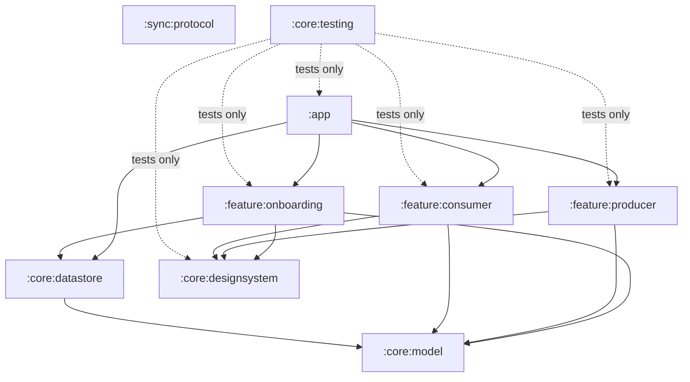

# Architecture

This describes the code as it exists today. The full target design is in [PLAN.md](PLAN.md) (§4).

## Modules

| Module | Kind | Purpose |
|---|---|---|
| `:app` | Android app | Activity, navigation (Navigation 3), Hilt graph |
| `:feature:*` | Android library | Screens and their ViewModels, one module per screen group |
| `:core:designsystem` | Android library | Theme, colours, icons, shared components |
| `:core:datastore` | Android library | Persistent settings (DataStore) |
| `:core:model` | Pure Kotlin | Domain types shared everywhere |
| `:core:testing` | Android library | Fakes, test rules, screenshot helper |
| `:sync:protocol` | Pure Kotlin | Wire protocol: frame encoding and decoding |

The plan adds `sync:engine`, `transport:*`, `connector:*`, `core:metadata`, `core:media`, `core:crypto` and `core:database` in the milestones that need them.

## Rules

1. **Features never depend on other features.** Navigation between them happens in `:app`.
2. **Sync logic stays pure Kotlin** (`sync:*`, `core:model`, later `core:metadata`, `transport:api`, `connector:api`). These modules have no Android dependency, their tests run on the JVM in milliseconds, and they're ready for a future desktop consumer.
3. **Android-specific code stays at the edges:** MediaStore, the keystore, WorkManager and Wi-Fi P2P each live behind an interface.
4. **One-way data flow in the UI:** a ViewModel exposes a `StateFlow` of UI state, and screens send events up as callbacks. Screens are stateless composables, wrapped by a thin `…Route` that obtains the ViewModel. This keeps every screen testable without Hilt.
5. **Build configuration lives in convention plugins** (`build-logic/`). Module build files only declare their namespace and dependencies.

## Quality gates

| Gate | Tool | Where |
|---|---|---|
| Formatting + license header | Spotless (ktlint) | every module, root scripts, build-logic |
| Static analysis | detekt, Android Lint (warnings are errors) | every module |
| Dependency licenses | Licensee (allowlist) | `:app` runtime classpath |
| Coverage | Kover: ≥ 70 % overall, ≥ 85 % for `sync:*` | aggregated at the root |
| UI regressions | Roborazzi screenshot tests | design system and feature screens |
| Compiler warnings | `allWarningsAsErrors` | every Kotlin compilation |

## Rendezvous Worker

`infra/rendezvous/` is a separate TypeScript project: the Cloudflare Worker for internet sync (PLAN §8.4, §8.5). It has no code in common with the app; the two meet only at the HTTP API in [ADR 0009](adr/0009-rendezvous-device-authentication.md).

| Part | Purpose |
|---|---|
| Worker (`src/router.ts`) | Rate limits, verifies each request's signature (the phone's keystore key), routes |
| `PairMailbox` Durable Object | One per pair: who belongs to it, the consumer's FCM token, the signaling WebSockets |
| `UsageMeter` Durable Object | One per deployment: relay usage from analytics and live reports, the budget guard |
| Cron trigger | Every 15 minutes, reads relay usage from Cloudflare's analytics |

Its gates run in CI's `Rendezvous Worker` job: license headers, strict type check, Vitest in the Workers runtime, and a dry-run bundle.
